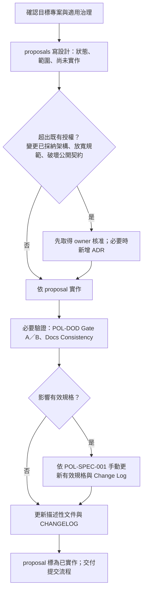
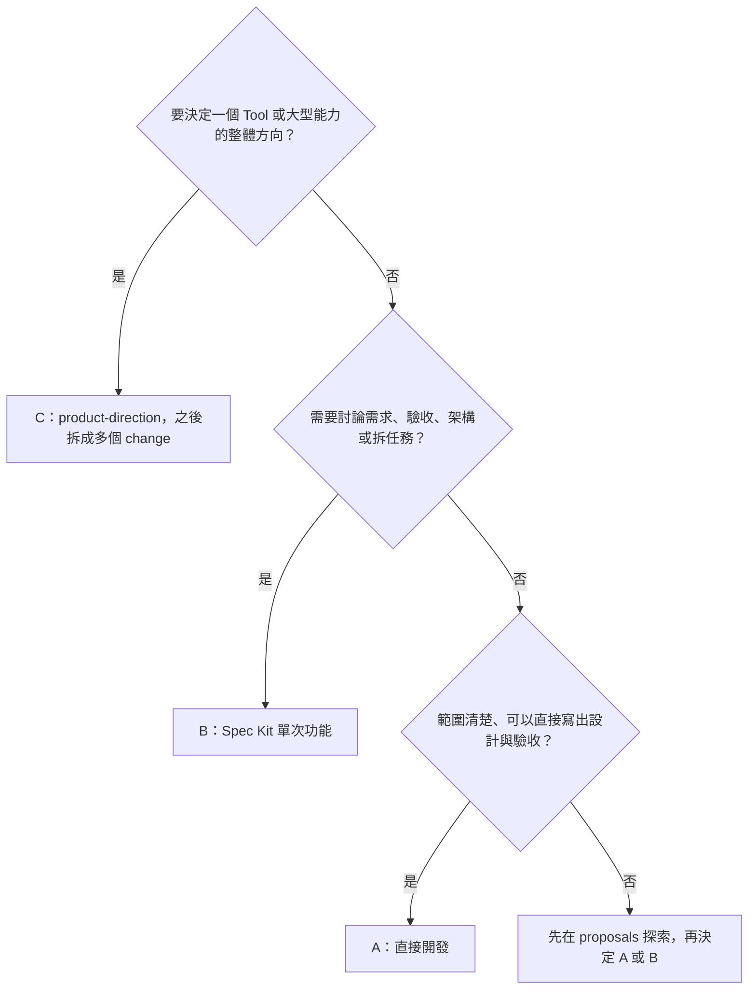
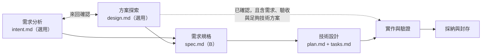

# 開發流程：三種顆粒度與使用的目錄

> Intent 管理擴充（ADR-0006 與 intent-workflow.md）目前為待採納提案；本次新增的修訂、快照與來源格式說明不因此成為已生效的治理規則。

本文是 Hub 與各 Tool **選擇開發流程的正本**：不用 Spec Kit 的工作、用 Spec Kit 的單次功能、完整 Tool 的方向設計，各自怎麼做、文件放在哪裡、如何收尾。決策出處見 [ADR-0003](../architecture/decisions/0003-development-workflow-granularity.md)。

> **先選流程，再看工具大小。** 流程依**需求的性質**決定（需不需要討論需求、驗收、架構與任務；會不會影響有效規格），不是只看程式碼行數或工具大小。
>
> 三種流程都要遵守適用的憲章與 Policy、**設計先於實作**、**規格唯一**。不用 Spec Kit **不等於**免治理、免設計、免驗證或免採納。

> **兩個維度**：A／B／C 是**流程選擇**（本文 §1–§8）；需求分析、方案探索、需求規格、技術設計、實作與驗證、採納與封存六個**工作階段**是工作進程與溝通用詞（§10，決策見 [ADR-0005](../architecture/decisions/0005-proposals-location-and-development-process.md)）。六個階段不是另一種流程，也不強迫每次全走；可以省略文件，不省略實作依據。

目錄的通用用途見 [worktree 並行開發](parallel-development.md)；Spec Kit 指令的細節與已知限制見 [Spec Kit 工作流程](speckit-workflow.md)。

## 1. 對照表

| | A. 直接開發（不用 Spec Kit） | B. 單次功能（用 Spec Kit） | C. 完整 Tool 方向 |
|---|---|---|---|
| 適用 | 範圍清楚、需求不需多輪討論的修改；例如一個小 skill、腳本、文件修正、錯誤修正 | 需要討論需求、驗收、架構與任務的一項功能或 change | 新 Tool 或大型能力的整體方向；之後拆成多個 B（或 A） |
| 設計稿與設計依據放哪裡 | 所屬專案 `docs/proposals/<topic>.md`；小修正可引用既有設計（§4.3） | 探索：`docs/proposals/<topic>.md`；正式輸入（選用）：`docs/intent/<NNN-name>/` | 該 Tool 的 `docs/proposals/product-direction/` |
| 需要 `.specify/` 嗎 | **不需要** | 需要（目標專案自己的） | 撰寫方向文件時不需要；之後的每個 B 需要 |
| 實作基準 | 審閱過的 proposal（含本次範圍） | 審查後的工作包 `specs/<NNN-name>/` 的 spec、plan、tasks | 不直接作為實作基準；每個 change 重新界定範圍 |
| 驗證紀錄 | proposal 的「驗證紀錄」一節，或 `<topic>/verification.md`；含開始時的 baseline-commit | `specs/<NNN-name>/verification.md` | 各個 change 自己的紀錄 |
| 影響有效規格時 | 驗證後依 POL-SPEC-001 手動更新有效規格與 Change Log，Archive 欄指向該 proposal | 驗證後 adopt、archive（擴充指令或依 Policy 手動） | 各 change 依 capability 分別採納 |
| 收尾 | proposal 標為已實作並結案，連到提交；更新描述性文件 | 封存到 `archive/changes/<NNN-name>/` | 方向文件持續作為草稿；roadmap 未來項不是已批准實作 |

> 有效規格的正本只有一份：`docs/specifications/<capability>/spec.md`。proposal、intent、工作包都不是現況。

## 2. 文件狀態：草稿、決策、本次範圍、尚未實作

每份 proposal（以及 product-direction 文件）開頭都要寫清楚四件事，避免把核准的方向寫成已交付：

```markdown
- 狀態：草稿 / 審閱中 / 已確認（本次實作基準）/ 實作中 / 已實作（結案）/ 已轉為 change <NNN-name> / 已撤回
- 目前決策：已確定的取捨與核准來源（使用者指示、ADR、既有授權）；沒有就寫「尚無」
- 本次範圍：這次要實作與驗證的部分
- 尚未實作：已討論但不在本次範圍、或尚未核准的部分
```

**效力**

- 文件放在 `proposals/`、或寫成草稿，**本身不等於批准**；它沒有 Policy、有效規格或描述性架構文件的效力，也不代表功能已存在。
- 在**既有授權內**經審閱確認的本次設計（狀態「已確認」），**可以作為本次實作的基準**（憲章原則 VI）。超出既有授權的部分，仍須先取得 owner 核准。

**哪些可以改、哪些不改寫**

| 文件 | 處理 |
|---|---|
| 草稿、審閱中、已確認但尚未實作的設計 | 可以修改；例行工作不另設核准關卡 |
| C 的方向文件（`product-direction/`） | 可以隨了解持續演進；其中已採納的決策依原程序變更 |
| **結案的** proposal（已實作、已轉為 change、已撤回）中的設計、驗證與採納紀錄 | **留在原處，不改寫內容**；只更新導覽、連結、狀態等必要的 metadata。後續變更開新的 topic 或 change，並連回這份紀錄 |
| 已採納的設計版本（例如 ADR 附件中的設計快照）與已採納 ADR | 唯讀快照，不改寫正文；變更已採納的決策依憲章原則 VI 取得 owner 核准，新增 ADR |

不要把所有方向稿都當成唯讀，也不要改寫已結案的歷史紀錄。轉為 change 時的紀錄方式見 §11。

**同一 topic 的同一角色只有一份主稿**

- 一個 topic 有兩種角色：**需求分析**（`intent.md`）與**方案探索**（`design.md`）。兩者是不同責任，不是互相競爭的主稿，可以並存：`docs/proposals/<topic>/intent.md` 加 `docs/proposals/<topic>/design.md`。
- 小稿可以用**合併稿**：單檔 `docs/proposals/<topic>.md`，同時承擔兩種角色。**合併稿與分開的 `intent.md`／`design.md` 擇一**，同一 topic 不要同時有單檔合併稿與目錄內的主稿。
- **每個角色只有一份**：同一 topic 出現兩份需求分析、或兩份方案探索，才算重複。已確認是同一主題與同一角色的既有主稿，即使用的是其他舊命名，也沿用原檔與原格式，不另建第二份、不悄悄改名。`research.md`、`discussions.md` 等是選用的附件，不是第二份主稿。
- 各角色的主稿都要看狀態與轉換紀錄（§11）；不能因為其中一份沒有紀錄，就忽略另一份已被 change 承接。
- 尚未結案時，在同一份主稿上修訂；已結案的留作歷史，後續開新的 topic 或 change（見上表）。
- 不另設版本制度：主稿**不需要** v1／v2 或 semver 編號。Git 只能追溯**已提交**的版本；未提交的修訂沒有 Git 提交歷史，也不保證由 Git 保留。
- 需求分析（Intent）的**重要語意修訂**才記錄（日期、改了什麼、為什麼、真實依據，來源不明時標 pending）；錯字不需列。保存、修訂、多份需求的關係與快照，詳見 [Intent 管理](intent-workflow.md)（ADR-0006）。

## 3. 文件放在哪個專案

| 情況 | 放哪裡 |
|---|---|
| 工作屬於既有 Tool | 該 Tool 的 `projects/<id>/docs/...`。**不要**把既有 Tool 的文件留在 Hub |
| 工作屬於 Hub 本身（入口、治理、開發工具） | Hub 的 `docs/...` |
| Tool 尚未成立、owner 尚未確定 | 暫放 Hub `docs/proposals/`，文件開頭標明**預計 owner**。方向稿以該工具命名 topic（例如 `proposals/ai-queue/design.md`），**不要**讓不同工具共用 Hub 的同一份 `product-direction`。Tool 成立後**移入**該 Tool 的 `docs/`，修正所有連結，只保留一份正本 |

## 4. A. 直接開發（不用 Spec Kit）

### 4.1 目錄

```text
<project>/                              # Hub 根目錄，或 projects/<id>/
├─ docs/
│  ├─ proposals/
│  │  ├─ <topic>.md                     # 一般情況：一份就夠（可合併需求與探索）
│  │  └─ <topic>/                       # 內容多時才拆
│  │     ├─ intent.md                   # 選用：需求分析
│  │     ├─ design.md                   # 選用：方案探索（設計稿）
│  │     ├─ research.md                 # 選用：調查、比較
│  │     ├─ discussions.md              # 選用：討論紀錄、待決事項
│  │     └─ verification.md             # 選用：驗證紀錄較長時
│  └─ specifications/<capability>/spec.md   # 只有影響現況行為時才更新
├─ src/、tests/、scripts/ …            # 實作
└─ （不需要 .specify/；不建立工作包或正式 Intent）
```

> 專案依 POL-STRUCT-001 R3 或 Tool 範本，可能已經有空的 `specs/`、`docs/intent/`、`archive/changes/` 骨架。**骨架照常保留**；直接開發只是不在其中建立 `specs/<NNN-name>/` 工作包或 `docs/intent/<NNN-name>/` 正式輸入，也不需要初始化 `.specify/`。

問題、探索、方案比較、待決事項也放在 `proposals/`；**不另設** `docs/discovery/`、`docs/designs/`。

### 4.2 步驟



1. **確認目標**：哪個專案、讀它的憲章與 Policy 索引（workspace 模式另讀 Hub Policy 索引）、相關有效規格。記下**開始時的 `baseline-commit`** 與**可能受影響的 capability**（沒有就寫「不影響有效規格」）。
2. **寫設計**：新工具、新能力或新設計，在 `proposals/<topic>.md` 寫問題、方案、本次範圍、尚未實作、驗收方式，以及上一步的 baseline 與受影響 capability。範圍很小時可以只有幾段，但不能省略。已有適用設計的小修正見 §4.3。
3. **核准判斷**：只有超出既有授權時才需要 owner 核准（憲章原則 VI）。例行工作直接進行。
4. **實作**：依 proposal；實作中發現設計不足，**先改 proposal 再改程式**，不能先偏離再補文件。
5. **驗證**：依 POL-DOD-001 執行並記錄 Gate A（還原、建置、測試或可重現的最小驗證）、需要時 Gate B、Docs Consistency。紀錄寫在 proposal 的「驗證紀錄」一節，或 `<topic>/verification.md`。
6. **採納（只在影響現況行為時）**：依 POL-SPEC-001 R9a **手動**更新 `docs/specifications/<capability>/spec.md`：
   - **基線檢查**：比對目標有效規格（與要更新的索引）自第 1 步記下的 `baseline-commit` 以來，是否有已 commit、staged、未提交或新建的變更。有其他來源的變更或來源不明時，停止並重新比對，不覆蓋。
   - **安全套用**（POL-SPEC-001 R7 的原則同樣適用）：先在暫存位置產生完整結果並檢查 ID、連結與目標；套用前再檢查一次基線；失敗時只回復本次觸及的檔案，不清理其他變更，不自行 stage 或 commit。暫存位置可以用系統暫存目錄，**不需要為此初始化 Spec Kit**。
   - **內容**：穩定 requirement ID、不重複、不重用；Change Log 新增一列，**Archive 欄填該 proposal 的路徑**。
   - **採納紀錄**：在 proposal 的「採納紀錄」寫下驗證依據（連到驗證紀錄）、baseline、capability、新增／修改／移除的 requirement ID 與 Change Log 列。
7. **收尾**：proposal 狀態改為「已實作（結案）」，連到提交；更新描述性文件（架構、手冊、CHANGELOG）。結案後的設計、驗證與採納紀錄不改寫（§2）。

**階段對映**（§10）：步驟 1–2 是需求分析與方案探索（需求與驗收通常併在設計稿的「本次範圍」與「驗收方式」，即需求規格）；步驟 3 與設計稿的技術方案是技術設計；步驟 4–5 是實作與驗證；步驟 6–7 是採納與封存。

> **不冒充自動化**：`speckit-hub-adopt`／`archive` 只處理 `specs/<NNN-name>/` 工作包，**不處理** proposal。直接開發的採納是依 Policy 手動執行並留下紀錄；proposal 留在原處作為歷史，不移到 `archive/changes/`。

### 4.3 已有適用設計的小修正

設計先於實作，**不等於每次都要新寫一份完整設計**。錯字、文件措辭、明顯的錯誤修正、已確認設計範圍內的小調整，可以**引用**既有的適用設計（proposal、有效規格、ADR、Policy），不重寫設計。

但**本次的 Verification Record 仍須依 POL-DOD-001 R7 保存**，不能只寫在提交說明：

- 被引用的設計**尚未結案**：在它的「驗證紀錄」追加本次一筆。
- 被引用的設計**已結案**，或引用的是有效規格、ADR、Policy：不追加、不改寫原文件；改建一份輕量紀錄 `proposals/<topic>/verification.md`（或 `proposals/<topic>.md`，只寫驗證紀錄），內容是本次差異、理由、引用的設計、baseline-commit、驗證結果。**不需要**新寫完整設計。
- 提交說明可以摘要本次變更，並連到上述紀錄。

其他情況：

- 修正讓行為偏離或超出既有設計時，不屬於這一類：先改設計（或新開 proposal）再實作。
- 新工具、新能力或新設計，照 §4.2 寫新的 proposal。

## 5. B. 單次功能（用 Spec Kit）

### 5.1 目錄

```text
<project>/
├─ .specify/                            # 該專案自己的；使用前必須已初始化
├─ docs/
│  ├─ proposals/<topic>.md              # 選用：specify 前的未編號需求分析／方案探索
│  ├─ intent/<NNN-name>/                # 選用：正式輸入（沒有也可以 specify，見 §5.2）
│  │  ├─ intent.md                      # 本次問題與範圍
│  │  └─ decision.md                    # 選用：本次取捨
│  └─ specifications/<capability>/spec.md
├─ specs/<NNN-name>/                    # 工作包：spec、plan、tasks、verification …
└─ archive/changes/<NNN-name>/          # 完成或取消後的歷史
```

### 5.2 從探索到 change

```mermaid
flowchart LR
    P["proposals/topic.md<br/>未編號探索"] -->|範圍確定| G["確認目標與治理<br/>必要的初始化"]
    G --> CX["speckit-hub-context<br/>報錯即停止"]
    CX --> I["docs/intent/NNN-name/<br/>intent.md、decision.md<br/>（選用）"]
    I --> S["speckit-specify<br/>候選 spec"]
    S --> PL[clarify / plan / tasks / analyze]
    PL --> IM[implement]
    IM --> V["verify<br/>specs/NNN-name/verification.md"]
    V --> AD[adopt → 有效規格]
    AD --> AR[archive → archive/changes/]
```



1. **探索（選用）**：還沒確定要不要做、怎麼做時，先在 `proposals/<topic>.md` 討論問題與候選方案，**不編號**。
2. **確認目標與治理**：確定 owner 與目標專案；讀它的憲章與 Policy 索引（workspace 模式另讀 Hub Policy 索引）與相關有效規格。
3. **必要的初始化**：目標 Tool 必須已初始化**自己的** `.specify/`、整合與適用憲章（§5.3）。還沒做到時先完成這一步；**不要**在未初始化的 Tool 執行任何 Spec Kit 指令。
   - **workspace 模式**（Tool 在本 repo 開發）：Tool 必須登錄在 Hub 的 `workspace.json`；沒有登錄時 `context` 會報錯。
   - **standalone 模式**（已遷出或單獨使用的 Tool 目錄）：**不要求**登錄 Hub，也不要求 Hub 的檔案存在；使用 Tool 本地的憲章、內化的 workspace Policy 與版本固定的 distribution Policy 快照（POL-SPECKIT-001 R3）。內化或快照尚未完成時，如實記為缺口，不宣稱已完成。
4. **context**：在目標專案執行 `speckit-hub-context`，確認專案、模式與讀取清單。**報錯就停止**，不改用 Hub 或其他專案。
5. **編號**：`context` 的 `nextChange` 同時掃描 `specs/` 與 `archive/changes/`，但它**只是建議**：不會預留編號，原生 specify 也**不保證**使用它（G-NUM，見 [Spec Kit 工作流程](speckit-workflow.md)）。以它暫定 change 的 `<NNN-name>`（有正式 Intent 時，也是 intent 目錄的名稱）。
   specify 之後**核對實際建立的工作包編號**：
   - **與既有工作包或封存重複**：停止處理，不覆蓋。
   - **未重複、但和暫定的編號不同**：先確認兩者是同一個 change（名稱、內容、來源連結相符）。確認後，只要**沒有覆蓋別的輸入**、也**沒有其他工作依賴或預留**原本的編號，就把已建立的 intent 目錄（如果有）改成工作包的編號，並更新所有引用（proposal、spec 的來源連結、`decision.md`）。不能留下兩組錯配的編號；無法確認時停止並請 owner 決定。
   - 這是手動核對，**不是**自動編號功能。
6. **整理正式輸入（選用）**：需要時建立 `docs/intent/<NNN-name>/intent.md`。**沒有正式 Intent 也可以 specify**：直接以探索稿或使用者指示作為輸入，但必須記錄**來源、範圍與驗收**，不假裝已有正式 Intent。正式 Intent 從 topic 的早期 `intent.md` 整理時，**每個被承接的範圍**都要明確指定來源（多來源時列承接對照，不硬選一個全域唯一來源；見 [Intent 管理](intent-workflow.md) §8），並**凍結被承接的範圍**，不讓兩份同時被當成該範圍的現行需求（§10.1）。部分承接時，**不能**把整份需求分析凍結。正式 intent **只寫**：
   - 本次問題與情境；
   - 範圍與非目標；
   - 已確立的限制；
   - 未決事項；
   - 驗收方向；
   - 來源連結（proposal、有效規格、ADR、Policy）。

   **不要**先寫一份完整、與 spec 重複的規格；**不要**把探索時的所有候選方案當成需求。本次的取捨寫在 `decision.md`（需要時）。
7. **specify**：在**目標專案目錄內**呼叫 Claude `/speckit-specify`、Codex `$speckit-specify`，在訊息中指定實際存在的正式 intent（沒有就指定探索稿／需求來源，並寫明範圍與驗收）與要讀的有效規格（範例見 [Spec Kit 工作流程 §5](speckit-workflow.md#5-呼叫指令時要提供的上下文手動)）。產出的 spec 是**候選規格**，不是現況。
8. **plan / tasks / analyze**：技術細節在 plan，不寫進 intent 或 spec；任務拆分在 `tasks.md`。
9. **implement / verify**：驗證紀錄在 `specs/<NNN-name>/verification.md`（POL-DOD-001 R7）。
10. **adopt / archive**：依 POL-SPEC-001。可用 `speckit-hub-adopt`／`speckit-hub-archive`（目前要求的嚴格 Delta 格式尚未經使用者定案，見 [Spec Kit 工作流程](speckit-workflow.md)），或依 Policy 手動執行。被拒絕就照錯誤處理，不手動改有效規格繞過。
11. **探索文件的去向**：proposal 留在原處，在它的「轉換紀錄」追加一列（§11），狀態改為「已轉為 change `<NNN-name>`」並連到 intent；不再在 proposal 繼續寫本次需求，避免兩份正本。**封存時**（工作包與**實際存在的**正式 inputs 移到 `archive/changes/<NNN-name>/`；沒有 `docs/intent/<NNN-name>/` 時就沒有 `inputs/`），把 proposal 的連結改指向 `archive/changes/<NNN-name>/inputs/intent.md`（如果有）、`work/`，或採納後的現行有效規格；這是導覽 metadata 的更新，不改寫 proposal 的內容。

**階段對映**（§10）：步驟 1 是需求分析與方案探索（選用）；步驟 2–7 是需求規格；步驟 8 是技術設計（plan、tasks、analyze）；步驟 9 是實作與驗證；步驟 10–11 是採納與封存。

### 5.3 `.specify/` 的初始化時機

- **不使用 Spec Kit 的專案不需要初始化** `.specify/`；不為了「目錄合規」而初始化全套。
- **第一次要用 Spec Kit 時**（workspace 模式）分兩步：
  1. 在 **Tool 根目錄**（`projects/<id>/`）以固定上游版本（`tooling/speckit/UPSTREAM_VERSION`）的 CLI 初始化**它自己的** `.specify/` 與 Claude、Codex 整合。
  2. 回到**所屬 worktree 的 Hub 根目錄**執行 `node tooling/speckit/install.mjs --project-dir projects/<id>` 安裝 Hub 擴充。Tool 根目錄底下沒有 `tooling/`，不要在那裡執行這條命令。
- **standalone 模式**不能依賴 Hub 的 `tooling/` 路徑；依 POL-STRUCT-001 R8 部署本地、版本固定的 Spec Kit 指令與腳本。這部分的遷出流程**尚未完整驗收**（見 [遷移狀態](../migration-status.md) 的保留事項），不要假設已可使用。
- **未初始化時，不要在該 Tool 執行任何 Spec Kit 指令**：上游會往上找最近的 `.specify/`，會誤用 Hub 的設定，把工作包建到 Hub。
- 未初始化時，Hub 憲章與適用的 Hub Policy **仍然適用**，該 Tool 自己的 Policy 也適用。**不要**偽造 Tool 憲章，也**不要**把 Hub 憲章複製成第二份正本。Tool 需要自己的憲章時，依憲章修訂程序由 owner 核准後建立。

## 6. C. 完整 Tool 方向

### 6.1 目錄

```text
projects/<id>/                          # Tool 成立後；成立前可暫放 Hub proposals 並標明預計 owner
└─ docs/
   └─ proposals/
      └─ product-direction/
         ├─ design.md                   # 方向、責任／介面、能力、風險、未決
         └─ roadmap.md                  # 選用：能力拆分與候選順序
```

內容不多時，也可以只寫一份 `proposals/product-direction.md`。`product-direction` 這個名稱只用在 Tool 自己的 `proposals/`；Tool 尚未成立而暫放 Hub 時，以工具名稱命名 topic（§3）。

### 6.2 步驟

1. **寫方向**：目的、責任與邊界（Hub／Tool／Shared）、對外介面、主要能力、風險、未決事項、本次範圍、尚未實作。
2. **拆成能力**：拆成**可獨立驗收**的能力或 change；**不是**把設計的每個章節或每個 task 都開一個工作包。
3. **逐一進行**：每個能力依需求性質走 B（需要完整需求流程）或 A（範圍清楚的小修改）。每次新的（選用）Intent／spec／plan／tasks **重新界定範圍**，以當時的有效規格、治理與方向文件為參考，不直接把方向文件整份轉成任務。
4. **採納**：有效規格依 capability 分別採納，每個 capability 只有一份有效定義。
5. **維護方向文件**：每次拆出能力轉為 change，都在方向稿的「轉換紀錄」追加一列（§11）。方向文件可以隨了解演進修改，但已轉換的範圍不能藉修改方向稿改動需求；roadmap 的未來項目**不是已批准的全面實作**，也不排定承諾的時程。已實作的部分在方向文件標示並連到對應的 change 或有效規格。

**階段對映**（§10）：方向稿屬於方案探索，可以持續演進（已被承接的範圍凍結，§11.2）；拆出的每個能力各自走 A 或 B，經過各自需要的階段。

## 7. 如何避免重複規格

| 文件 | 寫什麼 | 不寫什麼 |
|---|---|---|
| proposal | 問題、探索、候選方案、取捨理由、本次範圍 | 已採納的現行需求全文 |
| 正式 intent（選用） | 本次問題、範圍、限制、未決、驗收方向、來源連結 | 完整規格、技術細節、所有候選方案 |
| 工作包 spec | 本次候選需求與驗收；修改既有 capability 時只寫差異並引用現況 | 與有效規格重複的未變更內容 |
| plan | 技術設計與 Policy Check | 需求本身 |
| 有效規格 | 驗證並採納後的現行需求 | 尚未驗證的提案 |

**引用優先於複製**：其他文件以 requirement ID 或連結引用有效規格，不另寫一套。

## 8. 選擇流程的判斷



- 直接開發途中發現需求變大、需要多輪討論時，可以改走 B：以 proposal 為來源（必要時整理正式 Intent）開新的 change。
- 不確定時，先寫 proposal；它在 A、B、C 都是合法的起點。

## 9. 現況與限制

- `speckit-hub-context`、`adopt`、`archive` 已實作，但完整設計與格式仍待確認；自動 Policy Check（G-PC）與原生編號接軌（G-NUM）尚未完成。見 [Spec Kit 工作流程](speckit-workflow.md) 的已知限制。
- 直接開發的採納沒有自動化工具，依 POL-SPEC-001 手動執行。
- 本文描述流程與目錄，不代表任何產品功能已實作。

## 10. 工作階段與溝通用詞

本節定義**工作進程**的六個階段，讓開發人員與 AI 討論時用同一組詞。決策出處見 [ADR-0005](../architecture/decisions/0005-proposals-location-and-development-process.md)。它和 A／B／C 是兩個不同的維度：

- **A／B／C 是流程選擇**：依需求性質決定這次走哪一種流程（§1、§8）。
- **六個階段是工作進程**：一項工作通常經過的階段。它**不是**第四種流程（沒有「D」），也**不強迫**每次都走滿六段。

### 10.0 流程圖



- **可以省略文件，不能省略實作依據**：實作前必須有清楚的需求、驗收與足夠的技術方案；它們可以寫在不同的文件，也可以合併在一份。
- `需求分析 ⇄ 方案探索` 是**雙向**的：探索發現需求問題要回到需求分析釐清；需求變清楚後也會影響方案。**不是**固定先後。
- `intent → spec`、`design → spec` 都合理；`intent → 實作` 通常不足（缺技術方案與驗收），不作為預設路徑；已有適用規格或設計的小修正可以引用既有依據（§4.3）。
- `design → intent` 只代表回饋或正式整理，**不是必經順序**，也**不得**強制把所有探索稿複製成 Intent。

### 10.1 六個階段

| 階段 | 目的 | 主要文件 | 可以省略嗎 |
|---|---|---|---|
| **需求分析** | 釐清問題、目標、使用者、範圍與限制 | topic 的 `intent.md`（選用）；單檔稿 `<topic>.md` 可合併 | 可省略文件 |
| **方案探索** | 提出方向、候選方案與待決事項 | **設計稿／草案**：topic 的 `design.md`（選用）或 `<topic>.md`；C 的方向稿 `product-direction/` | 可省略文件；範圍已清楚時直接進下一階段 |
| **需求規格** | 確立本次正式的需求、範圍與驗收 | B：工作包的候選 `spec.md`（specify、clarify），可引用正式 Intent（選用）。A：通常不另建文件，寫在適用的設計稿「本次範圍」與「驗收方式」 | A 可不另建文件，但行為與驗收仍須清楚；B 不跳過 |
| **技術設計** | 技術細節、計畫與任務拆分 | B：`plan.md`、`tasks.md`（analyze）。A：設計稿的技術方案 | 不省略實作依據；文件形式可以較輕 |
| **實作與驗證** | 依設計實作並驗證 | 程式、測試、`verification.md`（POL-DOD-001 R7） | 不省略 |
| **採納與封存** | 驗證後的採納（影響有效規格時）、文件更新、歷史保存與適用的封存 | 有效規格、Change Log、描述性文件、CHANGELOG；B：`archive/changes/<NNN-name>/`；A：結案的提案留在 `docs/proposals/` | 採納只在影響有效規格時；封存只適用工作包 |

說明：

- **檔案位置與檔名不是判斷階段的唯一依據**：同一份提案可能同時有需求分析、方案探索、直接開發的技術方案與驗證紀錄。判斷階段看**位置、內容與狀態**，不能單靠 `design.md` 這個檔名（約定只適用於 `docs/proposals/<topic>/` 內的主稿，不代表 repo 裡每個 `design.md` 都是探索文件）。
- **需求分析與方案探索是不同責任，不是互相競爭的主稿**。一個 topic 的**同一角色只有一份主稿**；只有同一角色出現兩份才算重複。單檔小稿 `<topic>.md` 可以合併兩者。
- **早期 intent 與正式 Intent 不同**：topic 下的早期 `intent.md` 是需求分析；正式 change 的 Intent 在 `docs/intent/<NNN-name>/`，選用。可以直接用探索稿或使用者指示 specify，但要記錄來源、範圍與驗收，**不假裝已有正式 Intent**。正式 Intent 若從早期 `intent.md` 整理，每個被承接的範圍都要明確記錄**來源與一份整合現行依據**（可並列多個相容來源，使用承接對照，見 [Intent 管理](intent-workflow.md) §8），並**凍結被承接的範圍**，不讓兩份同時被當成該範圍的現行需求。部分承接時，**不能**把整份需求分析（或整份方向稿）凍結；未被承接的範圍仍可演進。
- **Intent 的「唯一」指同 owner、同問題、同範圍在當下的需求依據，不是整個 repo 只有一份。** 新問題、獨立範圍或已結案後的新需求另開 topic 或 change，不當成同需求的 v2；多份 Intent 可以共同影響同一能力，關係（延伸、拆分、承接、取代）的記錄方式與現行、歷史的讀取方式見 [Intent 管理](intent-workflow.md)。Intent 不是正式行為規格，也不預先選實作方案；有效規格才是已驗證的現況。活動 change 的正式 Intent 修訂不自動代表候選 spec、設計與驗收已更新，需檢查後走既有流程。
- **方案探索可以省略**。產出的設計稿可以只作後續參考；在既有授權內經審閱確認後（§2 的「已確認」），且包含需求、驗收與足夠技術方案，也可以作為實作依據。小工具可以從設計稿**直接進入實作**，不另建 spec。
- **需求規格階段的候選 spec 是實作基準，不是現行有效規格**。有效規格只在採納後更新。
- **技術設計與實作與驗證是兩個階段**：先設計、再實作；實作中發現設計不足，先改設計再改程式。技術設計的產出（`plan.md`、`tasks.md`）和實作驗證分開看。
- **採納與封存是兩件事**：
  - 採納：只在影響有效規格時做（B 依 POL-SPEC-001 R5，A 依 R9a）。
  - 封存：B 的工作包與正式 inputs 封存到 `archive/changes/`。取消或被取代的工作包**只封存、不採納**。
  - A 的結案紀錄留在 `docs/proposals/`，**不需要**建立工作包或使用 archive 腳本。
  - **提案保留來源與轉換追蹤**。工具方向稿**已被承接（已轉換）的範圍凍結**，未承接的範圍可以演進；方向稿**不**整份跟著每個 change 封存。

### 10.2 與 A／B／C 的對映

| 流程 | 需求分析／方案探索 | 需求規格 | 技術設計 | 實作與驗證 | 採納與封存 |
|---|---|---|---|---|---|
| A 直接開發 | 選用；設計稿（§4.2 步驟 1–2） | 通常不另建文件；本次範圍與驗收寫在設計稿（步驟 2） | 設計稿的技術方案、核准判斷（步驟 3）；已有適用設計的小修正引用既有設計（§4.3） | 實作、驗證（步驟 4–5） | 手動採納（影響有效規格時）、結案（步驟 6–7） |
| B Spec Kit 單次功能 | 選用；未編號的提案（§5.2 步驟 1） | 確認目標、初始化、context、編號、（選用）正式 Intent、specify、clarify（步驟 2–7） | plan、tasks、analyze（步驟 8） | implement、verify（步驟 9） | adopt、archive，提案的連結更新（步驟 10–11） |
| C 完整 Tool 方向 | 方向稿，**持續演進**（§6.2 步驟 1、5） | 不在方向稿內進行；拆出的每個能力各自進行 | 同左 | 同左 | 同左；有效規格依 capability 分別採納（步驟 4） |

C 本身停留在方案探索的方向稿；拆出來的每個能力（§6.2 步驟 2–3）各自走 A 或 B，各自經過需要的階段。

### 10.3 溝通用詞

| 說法 | 意思 | 不是 |
|---|---|---|
| **需求分析**（早期 intent） | topic 的 `intent.md`（選用）：問題、目標、範圍、限制；可與方案探索來回確認 | 正式 change 的 Intent；也不是有效規格 |
| **設計稿**／**草案**（使用者說的「design」） | 方案探索階段的主稿：方向、候選方案、待決事項。本流程中 `docs/proposals/<topic>/design.md` 這個檔名就是指設計稿；約定只適用於這個位置 | 技術設計；也不是正式 Intent |
| **技術設計** | 技術設計階段：`plan.md` 與 `tasks.md`（任務拆分）；A 為設計稿的技術方案 | 方案探索的設計稿 |
| **正式輸入**（正式 Intent） | B 的 `docs/intent/<NNN-name>/`（選用） | 早期的 `intent.md`；設計稿 |
| **候選 spec** | 工作包 `spec.md`，本次的實作基準 | 現行有效規格 |
| **有效規格** | 採納後的現況：`docs/specifications/<capability>/spec.md` | 任何提案、Intent 或工作包 |
| **採納** | 把驗證過的變更寫進有效規格 | 封存 |
| **封存** | 把工作包與正式 inputs 移到 `archive/changes/` 保存歷史 | 採納；也不適用 A 的提案 |

與 AI 討論時，例如「先做方案探索，產出設計稿」、「需求先寫在 `intent.md`」、「這個小工具跳過需求規格，直接進技術設計」、「實作與驗證完成後再採納與封存」。

## 11. 探索稿的轉換紀錄

探索內容（需求分析、設計稿、方向稿）轉為 change 時，在**該角色的主稿**記錄轉換。一個 topic 的同一角色只有一份主稿（§10.1），轉換紀錄跟著各自的主稿；topic 同時有 `intent.md` 與 `design.md` 時，兩者**各自**有轉換紀錄。決策出處見 [ADR-0004](../architecture/decisions/0004-exploration-conversion-tracking.md)。本節不改變「同一 topic 的同一角色只有一份主稿」（§10.1）與六個工作階段（§10），也不引入版本編號。轉換紀錄（範圍轉成哪個 change）與需求**修訂記錄**（需求理解如何改變）是兩件事，後者見 [Intent 管理](intent-workflow.md)；建立或修訂 Intent 不是轉換。

### 11.1 格式

在主稿末尾放一節「轉換紀錄」，用 Markdown 表格，**每次轉換追加一列**：

```markdown
## 轉換紀錄

| 日期 | 轉換範圍 | 對應 change | 目前位置 | 來源 commit | 備註 |
|---|---|---|---|---|---|
| 2026-10-20 | 整份 | `002-retry-limit` | `specs/002-retry-limit/`（有正式 Intent 時另含 `docs/intent/002-retry-limit/`） | `a1b2c3d` | |
| 2026-11-02 | 章節「§3 佇列上限」 | `005-queue-cap` | `archive/changes/005-queue-cap/` | pending（未提交） | 提交後補上 commit |
```

| 欄位 | 寫法 |
|---|---|
| 日期 | 轉換的日期 |
| 轉換範圍 | `整份`，或明確的章節標題、能力名稱。部分轉換要寫到別人能找到原文的程度 |
| 對應 change | change ID（`<NNN-name>`）；直接開發（A）沒有 change ID 時，寫承接的 topic 路徑 |
| 目前位置 | 對應的工作包、（有的話）正式 Intent、封存或有效規格的**現在**位置。封存或採納後更新這一欄（導覽 metadata）。除了下一列「來源 commit」允許的補證據之外，不改寫其他欄 |
| 來源 commit | **真的包含**被轉換內容的 commit。探索稿還沒提交時，先提交；或寫 `pending（未提交）`。`pending` 可以在稿件提交後，補成**真正包含原轉換內容**的 commit。這是**補上證據，不是重寫轉換事實**：轉換的日期、範圍與對應 change 不變；補上時要確認該 commit 確實含有被轉換的內容。不得填寫不包含該內容的 commit，也**不得為了取得 commit 而由代理自動提交** |
| 備註 | 選填 |

主稿沒有任何轉換時，這一節可以不寫，或寫「尚無轉換」。

### 11.2 規則

- **只在真正轉換時追加**。建立、修訂設計稿不是轉換，不新增這一列；建立設計稿的指令也不能自動寫入轉換紀錄。
- **整份轉換**：主稿狀態改為「已轉為 change `<NNN-name>`」（§2）。原探索內容保留不改寫；本次需求的細節在對應的 change。
- **部分轉換**：主稿（尤其是 C 的方向稿）的其他部分可以繼續演進。**已轉換的範圍不能藉修改主稿改動需求**；要改，就在對應的 change 或新的 change 處理。主稿中已轉換的段落可以加註「已轉為 `<NNN-name>`，需求以該 change 為準」。
- **後續新範圍**：已結案或已轉換的範圍有新需求時，另開 topic 或 change，新的文件連回來源主稿與原轉換紀錄。
- 每份主稿開頭的「目前決策」「本次範圍」（§2）仍然有效，轉換紀錄不取代它們。
- **同 topic 的各角色都要看**：`design.md` 沒有轉換紀錄，不代表 `intent.md` 沒有被 change 承接，反之亦然。代理要讀各角色的狀態與轉換紀錄，不能只看其中一份。
- **凍結被承接的範圍**：正式 change 承接早期 `intent.md` 或方向稿的某個範圍後，該範圍凍結、需求以 change 為準；**部分承接時不能整份凍結**，未被承接的範圍仍可演進。

**一般主稿與方向稿的分流**

| | 一般主稿（`docs/proposals/<topic>.md` 或 `<topic>/intent.md`、`<topic>/design.md`） | 方向稿（`docs/proposals/product-direction/`） |
|---|---|---|
| 常見的轉換 | 整份轉為一個 change | 每次拆出一個章節或能力，轉為各自的 change |
| 轉換後主稿的狀態 | 「已轉為 change `<NNN-name>`」，探索內容不再修改 | 狀態不變，未轉換的部分繼續演進 |
| 之後有新需求 | 另開新的 topic 或 change，連回本稿 | 未轉換的範圍可在方向稿繼續討論；已轉換的範圍另開 change |

### 11.3 代理的判斷順序

代理（Codex、Claude、Gemini 等）在修改主稿或決定下一步之前，依序讀：

1. 同 topic **各角色主稿**（`intent.md`、`design.md` 或單檔 `<topic>.md`）開頭的**狀態**、目前決策與本次範圍。
2. 各角色主稿的**轉換紀錄**。
3. 紀錄指向的**工作包、正式 Intent、封存與有效規格**的實際內容。

然後判斷：沿用這份主稿、另開新 topic、延續既有 change，或需要釐清。

- **紀錄空白、缺欄、指向不存在的位置，或與工作包、有效規格矛盾時，不等於從未轉換**。先核對實際的工作包、封存與有效規格；仍無法確定時，請使用者釐清。
- **不能**因為紀錄空白就覆寫內容，也**不能**只靠檔名或 topic 名稱推測轉換關係。
- 已結案或已轉換的範圍，不在原處改寫（§2）。

## 12. 流程配套工具：`saintber-design` 與 Spec Kit 指令

本節說明各階段、各流程使用哪些指令，讓開發人員與 AI 用**同一組流程與工具**。`saintber-design` 的決策出處見 [ADR-0004](../architecture/decisions/0004-exploration-conversion-tracking.md)（使用者核准的正式名稱）。

### 12.1 `saintber-design`：只處理方案探索草案

`saintber-design` 是本 repo 開發用的 **AI 技能／指令**，協助代理建立或更新**方案探索階段的設計稿／草案**（§10），並判斷下一步。它讀取已有的需求分析（topic 的 `intent.md`），但**不改寫**，也不自動執行其他階段。

> **它不等於 `speckit-plan` 的技術設計。** 兩者是不同階段的不同產物：
>
> - `saintber-design`：方案探索階段，產出 `docs/proposals/` 裡的**設計稿／草案**（方向、候選方案、待決事項）。
> - `speckit-plan`：技術設計階段，依工作包的 spec 產出技術計畫。上游 v1.1.0 實際的產物是 `plan.md`、`research.md`、`data-model.md`、`quickstart.md` 與 `contracts/`，**沒有名為 `design.md` 的產物**（依 `.specify/templates/plan-template.md` 與 `speckit-plan` 技能查證）。不要假設 plan 的輸出叫 `design.md`；`design.md` 在本流程只是 `docs/proposals/<topic>/design.md` 這個**方案探索主稿**的檔名約定（§10.3）。

> 它是給代理遵循的指引，由代理讀檔判斷後執行；**不是**有端到端機械保護的工具。部署器只負責安裝檔案並比對受管理的檔案，不檢查主稿內容。

| 代理 | 呼叫 | 安裝後的位置 |
|---|---|---|
| Codex | `$saintber-design` | `.agents/skills/saintber-design/SKILL.md` |
| Claude Code | `/saintber-design` | `.claude/skills/saintber-design/SKILL.md` |
| Gemini CLI | `/saintber-design` | `.gemini/commands/saintber-design.toml` |

- 正本是 `tooling/skills/saintber-design/SKILL.md`。三個入口是同一套邏輯，由 `node tooling/skills/saintber-design/install.mjs --project-dir <目標專案>` 從正本產生（在 Hub 根目錄執行）；**不要手改**產生的入口，也不影響 `speckit-*`。安裝與使用細節見 [`tooling/skills/saintber-design/README.md`](../../tooling/skills/saintber-design/README.md)。
- 參數用自然語言，可以帶 `project=hub|forge-explorer`、`topic=<name>`、`kind=topic|direction`、`owner=<擁有者>`、`from=<來源主稿>`。`kind=topic`（預設）是一般探索稿，`kind=direction` 是工具方向稿；兩者都**不是**正式的 change。`owner` 只是記錄在稿件的預計 owner，**不取代**既有的治理與核准。
- 新稿預設建立單檔 `proposals/<topic>.md`，內容多時才用 `proposals/<topic>/design.md`（與 §2 一致）。既有主稿沿用原檔與原格式。
- 指定了不存在的專案 ID 時，代理**不會**把它當成 Hub。尚未成立的 Tool 要明確指定 Hub，並寫出預計 owner（§3）。

**它做什麼、不做什麼**

| 會做 | 不會做 |
|---|---|
| 建立新的設計稿，或修訂仍可變的探索範圍 | 替使用者執行 specify、實作、adopt、archive、stage、commit |
| 依 §11.3 的順序讀狀態、轉換紀錄、工作包、封存與有效規格，判斷結果是 **reuse**（沿用既有主稿）、**new**（另開 topic）、**continue-change**（延續既有 change）或 **needs-clarification**（需要釐清） | 自動新增轉換紀錄：建立或修訂設計稿**不是**轉換 |
| 新 topic 連回來源 | 覆蓋重名的 topic，或格式不同的既有主稿 |
| 只修改探索範圍 | 改動已結案、已轉換的部分，或同一份主稿中的技術方案與驗證紀錄 |

判斷不出來、或紀錄與實際內容矛盾時，結果是 **needs-clarification**，由使用者決定。

### 12.2 六階段的工具對照

| 階段 | `saintber-design` | Spec Kit（流程 B） | 直接開發（流程 A） |
|---|---|---|---|
| 需求分析 | 不使用：只**讀取**已有的 `intent.md`，不改寫；探索發現需求問題時回報釐清。需求分析用 `saintber-intent`（§12.5） | 不使用 | 選用；可用 `saintber-intent`（§12.5），也可以手動依 [Intent 管理](intent-workflow.md) 撰寫 |
| 方案探索 | **使用**：建立或修訂設計稿 | 不使用 | 同左；選用 |
| 需求規格 | 不使用 | `speckit-hub-context`、`speckit-specify`、`speckit-clarify` | 不用 Spec Kit；範圍與驗收寫在設計稿。若需要規格整理，由人或 AI 依治理處理，不排除其他工具 |
| 技術設計（`plan.md`、`tasks.md`） | 不使用 | `speckit-plan`、`speckit-tasks`、`speckit-analyze`（唯讀） | 不使用 Spec Kit；技術方案寫在設計稿 |
| 實作與驗證 | 不使用 | `speckit-implement`；驗證寫在 `verification.md` | 不使用 Spec Kit；依設計稿實作與驗證 |
| 採納與封存 | 不使用。轉換紀錄在**建立或承接 change 時**依 §11 記錄，**不由 `saintber-design` 執行**；這個階段只更新紀錄中的追溯位置 | `speckit-hub-adopt`、`speckit-hub-archive`（有已知限制，見下） | 依 POL-SPEC-001 R9a **手動**採納；結案紀錄留在 `proposals/` |

- 呼叫方式：Claude Code 用 `/speckit-…`，Codex 用 `$speckit-…`（連字號）。
- **Gemini 只保證 `saintber-design`、`saintber-intent` 的 TOML 入口已安裝**。本 repo 的 Spec Kit 整合目前只有 Claude 與 Codex（`.specify/integration.json`），**沒有** Gemini 的 Spec Kit 指令，不要假設 Gemini 能執行 `speckit-*`。
- `speckit-analyze` 是**唯讀**檢查（上游設定），不會修改檔案。
- `speckit-hub-*` 是本 repo 的擴充，不是上游指令，各自的範圍不同：
  - `speckit-hub-context`：解析目標專案與模式，並載入該專案的治理（憲章、Policy 索引、有效規格索引）；不限於工作包，也不修改檔案。
  - `speckit-hub-adopt`、`speckit-hub-archive`：**只處理** `specs/<NNN-name>/` 工作包，不處理 proposal（§4.2 的提醒）。
- **檔名 `design.md` 不能單獨用來判斷工作階段**：既有的 `docs/proposals/` 文件可能同時有探索內容、技術設計與驗證段落。判斷階段看**位置、內容與狀態**（§10.1）。

### 12.3 A／B／C 的使用順序

| 流程 | 順序 | 要不要用 Spec Kit |
|---|---|---|
| **A 直接開發** | （選用）需求分析（`saintber-intent`）⇄ `saintber-design` 方案探索 → 依設計稿實作與驗證（需求、驗收、技術方案須齊全）→ 手動採納（影響有效規格時）→ 結案 | **不需要，也不要變成強制**。直接開發不必初始化 `.specify/` |
| **B 單次功能** | （選用）需求分析（`saintber-intent`）⇄ `saintber-design` 方案探索 → 確認目標與必要的初始化 → `speckit-hub-context`（報錯就停止）→（選用）整理正式 Intent → `speckit-specify`、`speckit-clarify` → `speckit-plan`、`speckit-tasks`、`speckit-analyze` → `speckit-implement` 與驗證 → adopt、archive | 需要（目標專案自己的 `.specify/`）。步驟細節與編號核對見 §5.2 |
| **C 完整 Tool 方向** | `saintber-design kind=direction` 寫方向稿（方案探索） → 拆成多個可獨立驗收的能力 → 每個能力各走 A 或 B | 方向稿本身不需要；拆出的每個 B 需要 |

採納與封存的工具有已知限制：`speckit-hub-adopt`／`archive` 目前要求嚴格的 Delta 格式，格式尚未經使用者定案；自動 Policy Check（G-PC）與原生編號接軌（G-NUM）尚未完成。見 [Spec Kit 工作流程](speckit-workflow.md) 的已知限制。直接開發的採納沒有自動化工具。

### 12.4 現況

- **可用**：技能正本、安裝器與三代理入口已建立，並已安裝到 Hub 與 forge-explorer。是否可用以**是否已在該工作目錄安裝**判斷，不以是否已提交判斷。其他工作目錄或 Tool 要先執行安裝器。
- **驗收範圍分開看**：
  - 安裝器有自動化部署測試（三入口一致、重複安裝、升級、保留本地修改、非法目標、symlink／junction 邊界），見 [`tooling/skills/saintber-design/README.md`](../../tooling/skills/saintber-design/README.md)。
  - 技能內容的判斷情境、Gemini TOML 的解析，由另外的驗證記錄；**不要**把部署測試通過當成判斷行為已驗收。
  - Gemini CLI 沒有在實機驗收。
- 安裝器**沒有**跨程序鎖或多檔原子交易；中途失敗可能留下部分更新的入口，修正後重跑。技能本身沒有機械鎖，主稿狀態由代理讀檔判斷。
- 本指令原暫名 `forge-design`，使用者已核准正式名稱 `saintber-design`；歷史驗證紀錄保留當時的名稱，見 ADR-0004 的更名註記。

### 12.5 `saintber-intent`：需求分析階段的技能

`saintber-intent` 處理需求分析階段：建立或修訂早期需求稿，判斷結果 `reuse`／`new`／`continue-change`／`needs-clarification`。它與 `saintber-design` 互相只讀不改：`saintber-intent` 讀設計稿、只改需求分析（合併稿只改需求部分）。管理規則見 [Intent 管理](intent-workflow.md)，設計與歷史見 [`intent-management/design.md`](../proposals/intent-management/design.md)。

| 代理 | 呼叫 | 安裝後的位置 |
|---|---|---|
| Codex | `$saintber-intent` | `.agents/skills/saintber-intent/SKILL.md` |
| Claude Code | `/saintber-intent` | `.claude/skills/saintber-intent/SKILL.md` |
| Gemini CLI | `/saintber-intent` | `.gemini/commands/saintber-intent.toml` |

- 正本是 `tooling/skills/saintber-intent/SKILL.md`，由獨立的 `node tooling/skills/saintber-intent/install.mjs --project-dir <目標專案>` 產生入口；與 `saintber-design` 可分別安裝，**不依賴 Spec Kit**。安裝、使用與安裝器限制見 [`tooling/skills/saintber-intent/README.md`](../../tooling/skills/saintber-intent/README.md)。
- **範圍**：只動需求分析稿；不改 spec／plan／tasks、程式或有效規格，不執行承接、adopt、archive、stage、commit。既有活動 change 已有正式 Intent 且使用者要求修訂時可依版本規則修訂；沒有正式 Intent 時只回報（`continue-change`），不建立正式輸入。
- **現況**：已部署到 Hub 與 forge-explorer；部署測試與 Claude 隔離情境驗證通過，範圍見 [交付紀錄](../proposals/saintber-intent-delivery/verification.md)。沒有獨立 Codex／Gemini CLI 端到端驗收；Gemini 只驗證 TOML 與內容。這是 AI 讀檔判斷的技能，沒有機器解析器或狀態鎖。
- **治理效力**：ADR-0006 與 POL-DOC-001 P1 仍是 Proposed。技能依使用者要求實作並可使用，但這不等於其中的規則已被採納為強制 Policy；是否推廣為強制 Policy 留待後續。
