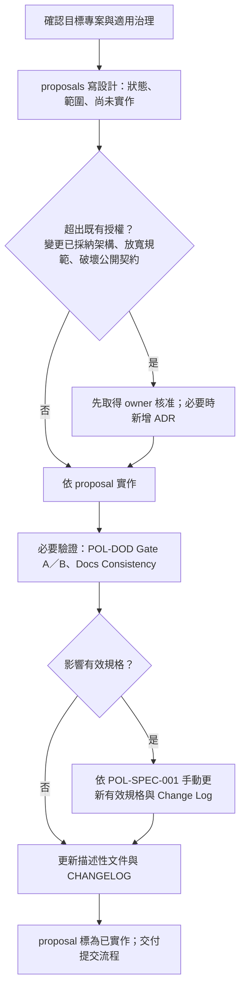
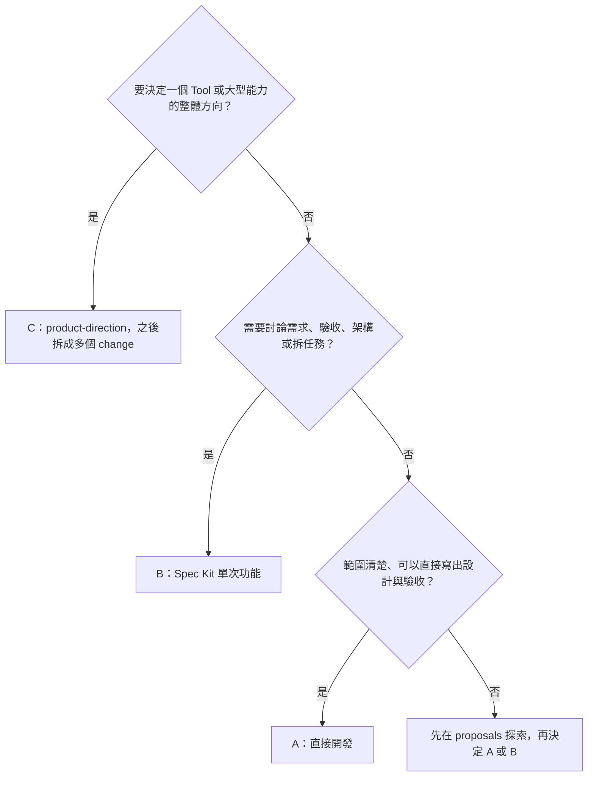

# 開發流程：三種顆粒度與使用的目錄

本文是 Hub 與各 Tool **選擇開發流程的正本**：不用 Spec Kit 的工作、用 Spec Kit 的單次功能、完整 Tool 的方向設計，各自怎麼做、文件放在哪裡、如何收尾。決策出處見 [ADR-0003](../architecture/decisions/0003-development-workflow-granularity.md)。

> **先選流程，再看工具大小。** 流程依**需求的性質**決定（需不需要討論需求、驗收、架構與任務；會不會影響有效規格），不是只看程式碼行數或工具大小。
>
> 三種流程都要遵守適用的憲章與 Policy、**設計先於實作**、**規格唯一**。不用 Spec Kit **不等於**免治理、免設計、免驗證或免採納。

目錄的通用用途見 [worktree 並行開發](parallel-development.md)；Spec Kit 指令的細節與已知限制見 [Spec Kit 工作流程](speckit-workflow.md)。

## 1. 對照表

| | A. 直接開發（不用 Spec Kit） | B. 單次功能（用 Spec Kit） | C. 完整 Tool 方向 |
|---|---|---|---|
| 適用 | 範圍清楚、需求不需多輪討論的修改；例如一個小 skill、腳本、文件修正、錯誤修正 | 需要討論需求、驗收、架構與任務的一項功能或 change | 新 Tool 或大型能力的整體方向；之後拆成多個 B（或 A） |
| 設計放哪裡 | 所屬專案 `docs/architecture/proposals/<topic>.md`；小修正可引用既有設計（§4.3） | 探索：`proposals/<topic>.md`；正式輸入：`docs/intent/<NNN-name>/` | 該 Tool 的 `docs/architecture/proposals/product-direction/` |
| 需要 `.specify/` 嗎 | **不需要** | 需要（目標專案自己的） | 撰寫方向文件時不需要；之後的每個 B 需要 |
| 實作基準 | 審閱過的 proposal（含本次範圍） | 審查後的工作包 `specs/<NNN-name>/` 的 spec、plan、tasks | 不直接作為實作基準；每個 change 重新界定範圍 |
| 驗證紀錄 | proposal 的「驗證紀錄」一節，或 `<topic>/verification.md`；含開始時的 baseline-commit | `specs/<NNN-name>/verification.md` | 各個 change 自己的紀錄 |
| 影響有效規格時 | 驗證後依 POL-SPEC-001 手動更新有效規格與 Change Log，Archive 欄指向該 proposal | 驗證後 adopt、archive（擴充指令或依 Policy 手動） | 各 change 依 capability 分別採納 |
| 收尾 | proposal 標為已實作並結案，連到提交；更新描述性文件 | 封存到 `archive/changes/<NNN-name>/` | 方向文件持續作為草稿；roadmap 未來項不是已批准實作 |

> 有效規格的正本只有一份：`docs/specifications/<capability>/spec.md`。proposal、intent、工作包都不是現況。

## 2. 文件狀態：草稿、決策、本次範圍、尚未實作

每份 proposal（以及 product-direction 文件）開頭都要寫清楚四件事，避免把核准的方向寫成已交付：

```markdown
- 狀態：草稿 / 審閱中 / 已確認（本次實作基準）/ 實作中 / 已實作（結案）/ 已轉為 change <NNN-name> / 已撤回
- 目前決策：已確定的取捨與核准來源（使用者指示、ADR、既有授權）；沒有就寫「尚無」
- 本次範圍：這次要實作與驗證的部分
- 尚未實作：已討論但不在本次範圍、或尚未核准的部分
```

**效力**

- 文件放在 `proposals/`、或寫成草稿，**本身不等於批准**；它沒有 Policy、有效規格或描述性架構文件的效力，也不代表功能已存在。
- 在**既有授權內**經審閱確認的本次設計（狀態「已確認」），**可以作為本次實作的基準**（憲章原則 VI）。超出既有授權的部分，仍須先取得 owner 核准。

**哪些可以改、哪些不改寫**

| 文件 | 處理 |
|---|---|
| 草稿、審閱中、已確認但尚未實作的設計 | 可以修改；例行工作不另設核准關卡 |
| C 的方向文件（`product-direction/`） | 可以隨了解持續演進；其中已採納的決策依原程序變更 |
| **結案的** proposal（已實作、已轉為 change、已撤回）中的設計、驗證與採納紀錄 | **留在原處，不改寫內容**；只更新導覽、連結、狀態等必要的 metadata。後續變更開新的 topic 或 change，並連回這份紀錄 |
| 已採納的設計版本（例如 ADR 附件中的設計快照）與已採納 ADR | 唯讀快照，不改寫正文；變更已採納的決策依憲章原則 VI 取得 owner 核准，新增 ADR |

不要把所有方向稿都當成唯讀，也不要改寫已結案的歷史紀錄。

## 3. 文件放在哪個專案

| 情況 | 放哪裡 |
|---|---|
| 工作屬於既有 Tool | 該 Tool 的 `projects/<id>/docs/...`。**不要**把既有 Tool 的文件留在 Hub |
| 工作屬於 Hub 本身（入口、治理、開發工具） | Hub 的 `docs/...` |
| Tool 尚未成立、owner 尚未確定 | 暫放 Hub `docs/architecture/proposals/`，文件開頭標明**預計 owner**。Tool 成立後**移入**該 Tool 的 `docs/`，修正所有連結，只保留一份正本 |

## 4. A. 直接開發（不用 Spec Kit）

### 4.1 目錄

```text
<project>/                              # Hub 根目錄，或 projects/<id>/
├─ docs/
│  ├─ architecture/
│  │  └─ proposals/
│  │     ├─ <topic>.md                  # 一般情況：一份就夠
│  │     └─ <topic>/                    # 內容多時才拆
│  │        ├─ design.md
│  │        ├─ research.md              # 選用：調查、比較
│  │        ├─ discussions.md           # 選用：討論紀錄、待決事項
│  │        └─ verification.md          # 選用：驗證紀錄較長時
│  └─ specifications/<capability>/spec.md   # 只有影響現況行為時才更新
├─ src/、tests/、scripts/ …            # 實作
└─ （不需要 .specify/；不建立工作包或正式 Intent）
```

> 專案依 POL-STRUCT-001 R3 或 Tool 範本，可能已經有空的 `specs/`、`docs/intent/`、`archive/changes/` 骨架。**骨架照常保留**；直接開發只是不在其中建立 `specs/<NNN-name>/` 工作包或 `docs/intent/<NNN-name>/` 正式輸入，也不需要初始化 `.specify/`。

問題、探索、方案比較、待決事項也放在 `proposals/`；**不另設** `docs/discovery/`、`docs/designs/`。

### 4.2 步驟



1. **確認目標**：哪個專案、讀它的憲章與 Policy 索引（workspace 模式另讀 Hub Policy 索引）、相關有效規格。記下**開始時的 `baseline-commit`** 與**可能受影響的 capability**（沒有就寫「不影響有效規格」）。
2. **寫設計**：新工具、新能力或新設計，在 `proposals/<topic>.md` 寫問題、方案、本次範圍、尚未實作、驗收方式，以及上一步的 baseline 與受影響 capability。範圍很小時可以只有幾段，但不能省略。已有適用設計的小修正見 §4.3。
3. **核准判斷**：只有超出既有授權時才需要 owner 核准（憲章原則 VI）。例行工作直接進行。
4. **實作**：依 proposal；實作中發現設計不足，**先改 proposal 再改程式**，不能先偏離再補文件。
5. **驗證**：依 POL-DOD-001 執行並記錄 Gate A（還原、建置、測試或可重現的最小驗證）、需要時 Gate B、Docs Consistency。紀錄寫在 proposal 的「驗證紀錄」一節，或 `<topic>/verification.md`。
6. **採納（只在影響現況行為時）**：依 POL-SPEC-001 R9a **手動**更新 `docs/specifications/<capability>/spec.md`：
   - **基線檢查**：比對目標有效規格（與要更新的索引）自第 1 步記下的 `baseline-commit` 以來，是否有已 commit、staged、未提交或新建的變更。有其他來源的變更或來源不明時，停止並重新比對，不覆蓋。
   - **安全套用**（POL-SPEC-001 R7 的原則同樣適用）：先在暫存位置產生完整結果並檢查 ID、連結與目標；套用前再檢查一次基線；失敗時只回復本次觸及的檔案，不清理其他變更，不自行 stage 或 commit。暫存位置可以用系統暫存目錄，**不需要為此初始化 Spec Kit**。
   - **內容**：穩定 requirement ID、不重複、不重用；Change Log 新增一列，**Archive 欄填該 proposal 的路徑**。
   - **採納紀錄**：在 proposal 的「採納紀錄」寫下驗證依據（連到驗證紀錄）、baseline、capability、新增／修改／移除的 requirement ID 與 Change Log 列。
7. **收尾**：proposal 狀態改為「已實作（結案）」，連到提交；更新描述性文件（架構、手冊、CHANGELOG）。結案後的設計、驗證與採納紀錄不改寫（§2）。

> **不冒充自動化**：`speckit-hub-adopt`／`archive` 只處理 `specs/<NNN-name>/` 工作包，**不處理** proposal。直接開發的採納是依 Policy 手動執行並留下紀錄；proposal 留在原處作為歷史，不移到 `archive/changes/`。

### 4.3 已有適用設計的小修正

設計先於實作，**不等於每次都要新寫一份完整設計**。錯字、文件措辭、明顯的錯誤修正、已確認設計範圍內的小調整，可以**引用**既有的適用設計（proposal、有效規格、ADR、Policy），不重寫設計。

但**本次的 Verification Record 仍須依 POL-DOD-001 R7 保存**，不能只寫在提交說明：

- 被引用的設計**尚未結案**：在它的「驗證紀錄」追加本次一筆。
- 被引用的設計**已結案**，或引用的是有效規格、ADR、Policy：不追加、不改寫原文件；改建一份輕量紀錄 `proposals/<topic>/verification.md`（或 `proposals/<topic>.md`，只寫驗證紀錄），內容是本次差異、理由、引用的設計、baseline-commit、驗證結果。**不需要**新寫完整設計。
- 提交說明可以摘要本次變更，並連到上述紀錄。

其他情況：

- 修正讓行為偏離或超出既有設計時，不屬於這一類：先改設計（或新開 proposal）再實作。
- 新工具、新能力或新設計，照 §4.2 寫新的 proposal。

## 5. B. 單次功能（用 Spec Kit）

### 5.1 目錄

```text
<project>/
├─ .specify/                            # 該專案自己的；使用前必須已初始化
├─ docs/
│  ├─ architecture/proposals/<topic>.md # 選用：specify 前的未編號探索
│  ├─ intent/<NNN-name>/
│  │  ├─ intent.md                      # 本次問題與範圍（正式輸入）
│  │  └─ decision.md                    # 選用：本次取捨
│  └─ specifications/<capability>/spec.md
├─ specs/<NNN-name>/                    # 工作包：spec、plan、tasks、verification …
└─ archive/changes/<NNN-name>/          # 完成或取消後的歷史
```

### 5.2 從探索到 change

```mermaid
flowchart LR
    P["proposals/topic.md<br/>未編號探索"] -->|範圍確定| G["確認目標與治理<br/>必要的初始化"]
    G --> CX["speckit-hub-context<br/>報錯即停止"]
    CX --> I["docs/intent/NNN-name/<br/>intent.md、decision.md"]
    I --> S["speckit-specify<br/>候選 spec"]
    S --> PL[clarify / plan / tasks / analyze]
    PL --> IM[implement]
    IM --> V["verify<br/>specs/NNN-name/verification.md"]
    V --> AD[adopt → 有效規格]
    AD --> AR[archive → archive/changes/]
```



1. **探索（選用）**：還沒確定要不要做、怎麼做時，先在 `proposals/<topic>.md` 討論問題與候選方案，**不編號**。
2. **確認目標與治理**：確定 owner 與目標專案；讀它的憲章與 Policy 索引（workspace 模式另讀 Hub Policy 索引）與相關有效規格。
3. **必要的初始化**：目標 Tool 必須已初始化**自己的** `.specify/`、整合與適用憲章（§5.3）。還沒做到時先完成這一步；**不要**在未初始化的 Tool 執行任何 Spec Kit 指令。
   - **workspace 模式**（Tool 在本 repo 開發）：Tool 必須登錄在 Hub 的 `workspace.json`；沒有登錄時 `context` 會報錯。
   - **standalone 模式**（已遷出或單獨使用的 Tool 目錄）：**不要求**登錄 Hub，也不要求 Hub 的檔案存在；使用 Tool 本地的憲章、內化的 workspace Policy 與版本固定的 distribution Policy 快照（POL-SPECKIT-001 R3）。內化或快照尚未完成時，如實記為缺口，不宣稱已完成。
4. **context**：在目標專案執行 `speckit-hub-context`，確認專案、模式與讀取清單。**報錯就停止**，不改用 Hub 或其他專案。
5. **編號**：`context` 的 `nextChange` 同時掃描 `specs/` 與 `archive/changes/`，但它**只是建議**：不會預留編號，原生 specify 也**不保證**使用它（G-NUM，見 [Spec Kit 工作流程](speckit-workflow.md)）。以它暫定 intent 的 `<NNN-name>`。
   specify 之後**核對實際建立的工作包編號**：
   - **與既有工作包或封存重複**：停止處理，不覆蓋。
   - **未重複、但和 intent 的編號不同**：先確認兩者是同一個 change（名稱、內容、來源連結相符）。確認後，只要**沒有覆蓋別的輸入**、也**沒有其他工作依賴或預留**原本的編號，就把 intent 目錄改成工作包的編號，並更新所有引用（proposal、spec 的來源連結、`decision.md`）。不能留下兩組錯配的編號；無法確認時停止並請 owner 決定。
   - 這是手動核對，**不是**自動編號功能。
6. **整理正式輸入**：建立 `docs/intent/<NNN-name>/intent.md`。intent **只寫**：
   - 本次問題與情境；
   - 範圍與非目標；
   - 已確立的限制；
   - 未決事項；
   - 驗收方向；
   - 來源連結（proposal、有效規格、ADR、Policy）。

   **不要**先寫一份完整、與 spec 重複的規格；**不要**把探索時的所有候選方案當成需求。本次的取捨寫在 `decision.md`（需要時）。
7. **specify**：在**目標專案目錄內**呼叫 Claude `/speckit-specify`、Codex `$speckit-specify`，在訊息中指定上述 intent 與要讀的有效規格（範例見 [Spec Kit 工作流程 §5](speckit-workflow.md#5-呼叫指令時要提供的上下文手動)）。產出的 spec 是**候選規格**，不是現況。
8. **plan / tasks / analyze**：技術細節在 plan，不寫進 intent 或 spec。
9. **implement / verify**：驗證紀錄在 `specs/<NNN-name>/verification.md`（POL-DOD-001 R7）。
10. **adopt / archive**：依 POL-SPEC-001。可用 `speckit-hub-adopt`／`speckit-hub-archive`（目前要求的嚴格 Delta 格式尚未經使用者定案，見 [Spec Kit 工作流程](speckit-workflow.md)），或依 Policy 手動執行。被拒絕就照錯誤處理，不手動改有效規格繞過。
11. **探索文件的去向**：proposal 留在原處，狀態改為「已轉為 change `<NNN-name>`」並連到 intent；不再在 proposal 繼續寫本次需求，避免兩份正本。**封存時**（intent 與工作包移到 `archive/changes/<NNN-name>/`），把 proposal 的連結改指向 `archive/changes/<NNN-name>/inputs/intent.md`、`work/`，或採納後的現行有效規格；這是導覽 metadata 的更新，不改寫 proposal 的內容。

### 5.3 `.specify/` 的初始化時機

- **不使用 Spec Kit 的專案不需要初始化** `.specify/`；不為了「目錄合規」而初始化全套。
- **第一次要用 Spec Kit 時**（workspace 模式）分兩步：
  1. 在 **Tool 根目錄**（`projects/<id>/`）以固定上游版本（`tooling/speckit/UPSTREAM_VERSION`）的 CLI 初始化**它自己的** `.specify/` 與 Claude、Codex 整合。
  2. 回到**所屬 worktree 的 Hub 根目錄**執行 `node tooling/speckit/install.mjs --project-dir projects/<id>` 安裝 Hub 擴充。Tool 根目錄底下沒有 `tooling/`，不要在那裡執行這條命令。
- **standalone 模式**不能依賴 Hub 的 `tooling/` 路徑；依 POL-STRUCT-001 R8 部署本地、版本固定的 Spec Kit 指令與腳本。這部分的遷出流程**尚未完整驗收**（見 [遷移狀態](../migration-status.md) 的保留事項），不要假設已可使用。
- **未初始化時，不要在該 Tool 執行任何 Spec Kit 指令**：上游會往上找最近的 `.specify/`，會誤用 Hub 的設定，把工作包建到 Hub。
- 未初始化時，Hub 憲章與適用的 Hub Policy **仍然適用**，該 Tool 自己的 Policy 也適用。**不要**偽造 Tool 憲章，也**不要**把 Hub 憲章複製成第二份正本。Tool 需要自己的憲章時，依憲章修訂程序由 owner 核准後建立。

## 6. C. 完整 Tool 方向

### 6.1 目錄

```text
projects/<id>/                          # Tool 成立後；成立前可暫放 Hub proposals 並標明預計 owner
└─ docs/
   └─ architecture/
      └─ proposals/
         └─ product-direction/
            ├─ design.md                # 方向、責任／介面、能力、風險、未決
            └─ roadmap.md               # 選用：能力拆分與候選順序
```

內容不多時，也可以只寫一份 `proposals/product-direction.md`。

### 6.2 步驟

1. **寫方向**：目的、責任與邊界（Hub／Tool／Shared）、對外介面、主要能力、風險、未決事項、本次範圍、尚未實作。
2. **拆成能力**：拆成**可獨立驗收**的能力或 change；**不是**把設計的每個章節或每個 task 都開一個工作包。
3. **逐一進行**：每個能力依需求性質走 B（需要完整需求流程）或 A（範圍清楚的小修改）。每次新的 intent／spec／plan／tasks **重新界定範圍**，以當時的有效規格、治理與方向文件為參考，不直接把方向文件整份轉成任務。
4. **採納**：有效規格依 capability 分別採納，每個 capability 只有一份有效定義。
5. **維護方向文件**：方向文件可以隨了解演進修改；roadmap 的未來項目**不是已批准的全面實作**，也不排定承諾的時程。已實作的部分在方向文件標示並連到對應的 change 或有效規格。

## 7. 如何避免重複規格

| 文件 | 寫什麼 | 不寫什麼 |
|---|---|---|
| proposal | 問題、探索、候選方案、取捨理由、本次範圍 | 已採納的現行需求全文 |
| intent | 本次問題、範圍、限制、未決、驗收方向、來源連結 | 完整規格、技術細節、所有候選方案 |
| 工作包 spec | 本次候選需求與驗收；修改既有 capability 時只寫差異並引用現況 | 與有效規格重複的未變更內容 |
| plan | 技術設計與 Policy Check | 需求本身 |
| 有效規格 | 驗證並採納後的現行需求 | 尚未驗證的提案 |

**引用優先於複製**：其他文件以 requirement ID 或連結引用有效規格，不另寫一套。

## 8. 選擇流程的判斷



- 直接開發途中發現需求變大、需要多輪討論時，可以改走 B：把 proposal 整理成 intent，開新的 change。
- 不確定時，先寫 proposal；它在 A、B、C 都是合法的起點。

## 9. 現況與限制

- `speckit-hub-context`、`adopt`、`archive` 已實作，但完整設計與格式仍待確認；自動 Policy Check（G-PC）與原生編號接軌（G-NUM）尚未完成。見 [Spec Kit 工作流程](speckit-workflow.md) 的已知限制。
- 直接開發的採納沒有自動化工具，依 POL-SPEC-001 手動執行。
- 本文描述流程與目錄，不代表任何產品功能已實作。
