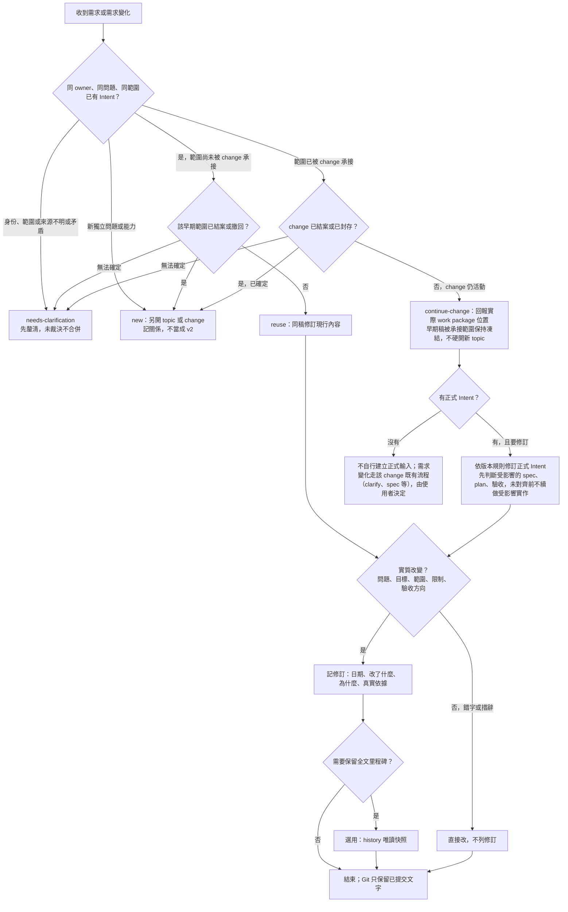

# Intent 管理：保存、修訂、多份需求與承接

> 狀態：管理擴充提案，待 owner 採納。既有規則仍以 ADR-0005 與現行 Policy 為準；本文不是已生效的新規範。

本文是 **Intent（需求依據）管理擴充的詳細草稿正本**：Intent 放哪裡、怎麼修訂、什麼時候另開、多份需求如何並存與承接、現行與歷史如何讀取。決策出處見 [ADR-0006](../architecture/decisions/0006-intent-management-strategy.md)；設計與候選策略比較見 [`intent-management/design.md`](../proposals/intent-management/design.md)。

> **範圍**：本文只說明文件的管理方式，**不新增**需求分析專用的指令（規劃中的 `saintber-intent` 尚未實作，現況見 §13），也不改變 A／B／C 流程與六個工作階段（[開發流程](development-workflows.md) §1、§10）。其他文件引用本文，不複製本文的規則全文。

## 1. Intent 是什麼

Intent 是**同一 owner、同一問題、同一範圍在當下的明確需求依據**，內容限於：

- 問題與情境、目的；
- 期待結果；
- 範圍與非目標；
- 已確立的限制；
- 未決事項；
- 驗收方向。

| Intent **是** | Intent **不是** |
|---|---|
| 為什麼要做、做到什麼算有意義、做多大 | 正式行為規格（那是工作包的 `spec.md`，採納後才是有效規格） |
| 當下對需求的理解，可以隨理解演進 | 實作方案：**不預先選方案**，候選方案寫在設計稿（方案探索） |
| 一個範圍一份現行依據 | 整個 repo 只有一份的全域需求文件 |

**「唯一」的意思**：同一 owner、同一問題、同一範圍，在**同一時間**只有一份現行的需求依據；**不是**整個 repo 只能有一份 Intent。不同問題、不同範圍的 Intent 可以並存，也可以共同影響同一個 capability（§8）。

**有效規格才是已驗證的現況**。Intent 不取代它；Intent 與有效規格不一致時，以有效規格為現況，Intent 是「想改成什麼」的依據（[開發流程 §7](development-workflows.md)）。

## 2. 位置與形式

| 階段 | 位置 | 選用？ | 說明 |
|---|---|---|---|
| 早期需求分析 | `docs/proposals/<topic>/intent.md` | 選用 | 與設計稿 `design.md` 是不同角色，可並存 |
| 早期需求分析（單檔小稿） | `docs/proposals/<topic>.md` | 選用 | 合併稿，同時承擔需求分析與方案探索 |
| 正式 change 的 Intent | `docs/intent/<NNN-name>/intent.md` | 選用 | 只在有建立正式輸入時；契約見 [Spec Kit 工作流程 §2](speckit-workflow.md) |
| 里程碑全文快照 | `docs/proposals/<topic>/history/intent-<id>.md` 或 `docs/intent/<NNN-name>/history/intent-<id>.md`（`<id>` 為唯一識別，見 §9） | 選用 | 唯讀歷史，不是第二份活動 Intent（§9） |

- **同一 topic、同一角色只有一份主稿**；合併稿與分開的 `intent.md`／`design.md` **擇一**（[開發流程 §2](development-workflows.md)）。已確認是同一主題的既有主稿，沿用原檔與原格式。
- 本文所有規則都不要求一定要有 Intent 文件：可以省略文件，**不能省略實作依據**（[開發流程 §10](development-workflows.md)）。
- 此歷史目錄**屬於該 topic 或該 change 的輸入局部**，不另設全 repo 的需求倉庫。

## 3. 流程

## 4. 早期 Intent 的修訂

**未結案時同稿迭代**，不強制版本號，不另產 `v1`／`v2`／semver 副本。

- **什麼要記**：問題、目標、範圍、限制、驗收方向的**實質改變**。錯字、措辭、排版**不需要**列修訂。
- **怎麼記**：在稿件的「需求修訂記錄」表追加一列：日期、改了什麼、為什麼、真實依據（§11 的最小格式）。
- **真實依據**：使用者指示（日期與出處描述）、已提交的 commit、ADR 或其他實際存在的文件。來源沒有記錄或稿件尚未提交時，**明確寫 pending**（例如 `pending（來源未記錄）`、`pending（未提交）`）；**不虛構**使用者指示或 commit。補上證據時，確認該 commit 真的包含被記錄的內容。
- **Git 的角色**：只保留**已提交**的文字歷史；未提交的修訂沒有 Git 歷史，也不保證被保留。因此重要的未提交修訂不要宣稱「可由 Git 還原」。
- 修訂記錄是**歷史，不是現行需求**；現行需求是稿件的現行內容（§10）。

## 5. 正式 Intent 的版本與索引

正式 Intent（`docs/intent/<NNN-name>/intent.md`）保留既有契約：**單檔、Intent Version Index、Current Effective Intent**（[Spec Kit 工作流程 §2](speckit-workflow.md)）。本節補充管理規則：

- **版本**是「需求理解的重要修訂」，**不是**程式版本或交付版本；可以用簡單序號（1、2、3…），**不是每改一個字就增加**，也**不強制 semver**。
- **版本代表需求語意**：問題、目標、範圍、限制、驗收方向有**實質改變**才換新版本號；錯字、措辭、排版等**非語意修正可以維持同一版本號**，不增版本。因此**同一版本號代表同一需求語意**，不得用同號表示不同需求；已記錄的版本摘要不回頭改寫其語意。
- **精確文字的定位**：同一版本號下的逐字差異，以 Git commit（僅已提交）或已保存的快照定位；版本號本身不保證逐字相同。
- **預設只存一份現行完整內容 + 修訂摘要**；完整的已提交舊文靠 Git 回看，**不強制**在同一檔案堆疊所有舊內容。
- **尚未提交的版本，不得宣稱 Git 可還原**；Evidence 寫 `pending（未提交）`，或另外保存里程碑快照（§9）。
- **Version Index** 記**重要修訂版本**：版本、日期、原因、摘要、真實依據（§11）。
- **現行段落要有明確的開始與結束邊界**：新建範本的建議格式為 `<!-- 現行範圍開始 -->` 與 `<!-- 現行範圍結束 -->`，各自獨立一行，兩者之間才是現行需求。**不能**用「Current 後面全部都是現行」的讀法，否則放在後面的歷史補充、相關文件會被誤讀為現行需求。邊界外的內容（相關文件、歷史補充）不是需求。

## 6. 什麼時候同稿、什麼時候另開

| 情況 | 處理 |
|---|---|
| 同一問題、同一範圍，理解變了，尚未結案 | **同稿修訂**（§4 或 §5） |
| 新問題、獨立範圍 | **另開 topic 或 change**，連回相關來源；不當成同需求 v2 |
| 已結案（已實作、已轉為 change 且封存、已撤回）後的新需求 | **另開 topic 或 change**，連回原紀錄；原稿不改寫（[開發流程 §2、§11](development-workflows.md)） |
| 同問題的範圍小幅調整（例如驗收邊界、某限制放寬） | **同稿實質修訂**（記修訂列）；不另開 |
| 一份稿裡其實有兩個獨立範圍 | **拆分**：擇一做法（同稿標示範圍，或拆成多份）；拆開後各範圍同樣「同一角色一份」，並記關係（§8） |
| 兩份稿其實是同一範圍 | **合併**前先確認同 owner、同問題、同範圍；來源矛盾時先釐清，**未裁決不合併**（§8） |

合併與拆分是兩種相反的整理方式，**同一 topic 同時間擇一**，不要在同一範圍同時有合併稿與拆分稿。

**判斷「同稿修訂」或「另開」看需求本身，不看字數或檔名**：問什麼問題、為誰、要達成什麼、驗收是否能獨立。例如（示例）：`retry-limit` 的上限由 3 次改為 5 次、或驗收由「停止」改為「停止並通知」，仍是同一問題，**同稿修訂**；但「新增依錯誤類型分流重試」是新的獨立能力，有自己的驗收，**另開** topic 並連回來源。拿不準時選 `needs-clarification`，由使用者決定。

## 7. 與 change 的關係：承接與凍結

- 正式 Intent 承接早期範圍後，**只凍結該被承接的範圍**，並記錄轉換證據（早期稿的「轉換紀錄」，[開發流程 §11](development-workflows.md)）。**部分承接不能整份凍結**；未承接的範圍仍可演進。
- 正式 Intent 本身在**活動中的 change** 可以依 §5 的版本規則演進。
- **修訂不自動等於 spec／plan／程式都已更新。** 活動 change 的正式 Intent 有實質修訂時：
  1. 先判斷受影響的候選 spec、plan／設計稿與驗收（哪些需求、任務、驗收受到影響）；
  2. 有不一致就**先釐清**，並更新相關的實作基準（spec、plan、tasks）與必要的驗證；
  3. **基準未對齊前，不續做受影響的實作**；
  4. **不直接拿 Intent 代替 spec**：候選 spec 才是本次實作基準，Intent 只是需求依據。

  這些由人與代理依既有流程（clarify、plan、analyze 等）進行；**修訂 Intent 的動作或工具不代做其他階段**。
- 活動的 change **沒有**正式 Intent 時：需求來源是記錄的早期稿或使用者指示，被承接範圍的早期稿保持凍結；需求變化回到該 change 的既有流程處理，**不另開重複 topic**、也不自行建立正式輸入（要不要建立由使用者決定）。
- 已確定結案或已封存的 change，其 Intent 是歷史；新需求另開（§6）。無法確定是否結案時先釐清。

## 8. 多份 Intent 的關係與多來源匯入

多份不同的 Intent 可以共同影響同一個能力。需要追溯時，**記關係**，不合併成一份：

| 關係 | 意思 | 注意 |
|---|---|---|
| 延伸 | 新 Intent 在另一份的基礎上擴大範圍 | 原稿不改寫 |
| 拆分 | 一份被分成多份，各自一個範圍 | 列出每份對應的原範圍 |
| 承接 | 後者接手前者（部分）的範圍，例如 change 承接早期稿 | 前者被承接的範圍凍結 |
| 取代 | 後者在其範圍內取代前者 | 前者被取代的範圍標為被取代；**取代需有明確來源**，不由代理推測 |

每筆關係都要：**明示是部分範圍或整份**，**指向實際存在的來源與對象**（路徑要存在，不寫想像中的文件）。

**多來源匯入同一個 change**：**不要硬選一個全域唯一來源**。改為指定**承接範圍與來源對照**（見 §11 的承接對照表）。「唯一」指的是**現行權威**：每個被承接的範圍只有**一份明確的整合現行依據**（正式 Intent 或記錄的需求依據中該範圍的內容）；但它**可以引用多個相容的歷史來源**，並保留範圍、來源、證據的對照。**同一範圍的來源互相矛盾時，先釐清；沒有裁決就不合併。**

**承接對照的存放與效力**：有正式 Intent 時，對照表放在其 Related Documents／來源 metadata 區；它記錄來源，不直接宣告需求。沒有正式 Intent 時，放在既有工作包 `specs/<NNN-name>/spec.md` 的「需求來源與承接對照」metadata 小節，不因此建立正式 Intent。被採用的需求整理在 Current Effective Intent（若有）及候選 spec 的需求內容；來源表在現行邊界外不代表失去追溯效力。

矛盾或未決來源可以進入 specify 的**草案**，須明確標 `NEEDS CLARIFICATION`，不把矛盾合成「已確認」需求。接著依 clarify 等既有流程釐清；受影響的需求、設計與驗收未對齊前，不進入受影響的實作。無需再設一個「所有問題先裁決才能建立 spec 草案」的關卡。

## 9. 里程碑全文快照（選用）

只在**確實需要**保留某個重要修訂的全文時才做，**不是每次修訂都做**，也**不強制每次寫 v1／v2 副本**。

- 位置：早期稿為 `docs/proposals/<topic>/history/intent-<id>.md`；正式輸入為 `docs/intent/<NNN-name>/history/intent-<id>.md`。`<id>` 是**唯一識別**（例如日期加序號，要能和修訂記錄對上）。
- 單檔合併稿 `docs/proposals/<topic>.md` 可以附帶 `<topic>/history/`：該目錄只有歷史附件，不能另放第二份活動 `intent.md` 或 `design.md`。快照標示來源角色；保存合併稿全文時標明「合併稿，含需求與探索」，保留原來源路徑，不把它當獨立現行 Intent。
- **若要保留修訂前的全文，先保存再修訂**：先確認舊文字是否已在某個 commit 或唯讀快照中；未保存而又需要逐字還原時，先建立選用快照。預設仍不強制保存每次未提交版本；只寫摘要而未保存全文時，不能宣稱可逐字還原舊文字。
- **不覆寫已存在的快照**，也不用同一個快照路徑表示不同的全文。同一版本號下需要另一份快照（例如同號但文字確有重要差異）時，選另一個唯一識別，並保留來源。
- 快照是**唯讀歷史**，開頭要寫清楚：這是哪個修訂的全文、現行正本的路徑、真實來源；**不是第二份活動 Intent**，不能被當成現行需求。
- **現行正本**要在修訂記錄或版本索引**明示引用**快照與其實際版本或來源。
- 快照已保存全文，所以**未提交也能由快照還原該版本**；但在提交之前**不要稱它已 commit**。
- 正式 Intent 的快照放在 change 的輸入目錄時，封存腳本本來就**按整個目錄封存**，不需要改程式。
- **不自動**建立快照、stage 或 commit。

## 10. 現行與歷史的讀取

| 要讀什麼 | 怎麼讀 |
|---|---|
| **早期 Intent 的現行需求** | 讀稿件開頭的狀態與現行內容；以「轉換紀錄」判斷哪些範圍已被 change 承接（已承接的範圍以 change 為準） |
| **正式 Intent 的現行需求** | 只讀 Current Effective Intent 在「現行範圍開始／結束」之間的內容；**不從 Version Index、歷史補充推導需求** |
| 為什麼改過 | 讀修訂記錄或 Version Index 的原因、摘要與依據；它是歷史，**不是需求** |
| 舊版全文 | 先找 `history/` 快照；沒有快照再看 Git（僅限已提交的版本）。同版本號的逐字差異以 commit 或快照為準 |
| 封存 | 預設**不讀作需求**，只在追溯歷史時明確讀取（POL-DOC-001 R5） |
| 多份 Intent 的關係 | 讀各份的關係表與轉換紀錄；缺漏、矛盾不等於沒有關係，先核對實際文件（[開發流程 §11.3](development-workflows.md)） |

**舊格式的讀取**：沒有邊界標记的封存 Intent 只作歷史，沿用當時文件與相關證據判讀，不能自行推導成現行需求，也不回改封存。活動中的舊格式若要修訂，先核對 Current Effective Intent、版本與需求章節，排除 Related Documents、Appendix 和歷史內容；確認範圍後才補上建議邊界。無法確認時先釐清，不以「Current 後全部」作預設。只補格式且未改需求語意時，不升需求版本；`Trigger` 舊欄位仍可辨識為原因。

## 11. 最小格式

> 以下表格是**最小格式**，欄位可依需要增加，但不要省略「真實依據」。表中的列都是**格式示意**；範例請看 §12，並注意示例不是真實事件。

**早期 Intent 的狀態標頭**：沿用 [開發流程 §2](development-workflows.md) 的狀態、目前決策、本次範圍、尚未實作四行；另可在「目前決策」記錄需求的核准來源。

**需求修訂記錄**（早期稿，放在稿件末尾；沒有實質修訂時可寫「尚無修訂」）：

| 日期 | 修訂內容（改了什麼） | 為什麼 | 真實依據 | 快照（選用） |
|---|---|---|---|---|
| `<日期>` | `<問題、目標、範圍、限制、驗收方向的哪一項>` | `<原因>` | `<使用者指示日期與出處／commit／pending（原因）>` | `<docs/proposals/<topic>/history/intent-<id>.md 或 無>` |

**Version Index**（正式 Intent）：

| Version | Date | Reason | Summary | Evidence |
|---|---|---|---|---|
| `<1>` | `<日期>` | `<原因>` | `<摘要（需求語意；非語意修正不增版本）>` | `<使用者指示日期與出處／commit／pending（未提交）>` |

> 舊樣本的欄位名稱 `Trigger` 即現在的 `Reason`（原因）；沿用舊欄位名稱的既有正式 Intent 不需要重寫，下次實質修訂時再對齊。

**關係表**（早期稿或正式 Intent 的「相關 Intent」節）：

| 關係 | 對象（實際存在的路徑） | 範圍（整份／部分，寫明哪一部分） | 日期 | 備註 |
|---|---|---|---|---|
| 延伸／拆分／承接／取代 | `<路徑>` | `<整份 或 部分：…>` | `<日期>` | |

**承接對照表**（多來源匯入同一個 change）：

| 承接範圍 | 來源（實際存在的路徑或記錄的使用者指示；相容的多個來源可並列） | 證據 | 狀態 |
|---|---|---|---|
| `<本 change 承接的範圍>` | `<來源 1；來源 2…>` | `<commit／日期／pending>` | `<已確認／待釐清（矛盾）>` |

每個範圍只有一份整合的現行依據；多個相容來源並列，矛盾的來源標「待釐清」且不合併。

「轉換紀錄」沿用 [開發流程 §11.1](development-workflows.md) 的格式；修訂記錄與轉換紀錄**不同**：前者記需求理解怎麼變，後者記範圍轉成哪個 change。建立或修訂 Intent **不是**轉換，不新增轉換列。

## 12. 範例

> **以下為示例，不是真實事件。** 所有 topic、change、日期、commit 都是虛構的格式示意，不代表已批准的事實，也不要把它們當成本 repo 的紀錄。

### 例 1：同一需求的修訂

示例 topic `retry-limit`（早期 Intent：`docs/proposals/retry-limit/intent.md`）。

1. 初稿寫：「失敗的工作重試上限為 3 次」。（尚未提交，沒有修訂列。）
2. 討論後，驗收方向由「達上限就停止」改成「達上限後記錄原因並通知」。這是**驗收方向的實質改變**，在修訂記錄追加一列：

   | 日期 | 修訂內容 | 為什麼 | 真實依據 | 快照 |
   |---|---|---|---|---|
   | `2026-xx-xx`（示例） | 驗收方向：達上限後需記錄原因並通知 | 只停止會讓使用者不知道失敗原因 | 使用者指示（示例：當日對話）；`pending（未提交）` | 無 |

3. 稿中一處「重新嘗試」改成「重試」：措辭，**不列修訂**。
4. 稿件仍是同一份，**沒有** `v2`。提交後，Git 保留已提交的文字；需要保留某一時點全文時才選用 `docs/proposals/retry-limit/history/intent-<id>.md`（示例路徑）。
5. 之後範圍由 change `002-retry-limit`（示例）承接：在 `intent.md` 的轉換紀錄追加一列（[開發流程 §11](development-workflows.md)），被承接的範圍凍結。若該 change 有正式 Intent 且後來實質修訂，依 §7 先判斷受影響的候選 spec、plan 與驗收；若沒有正式 Intent，需求變化回到該 change 既有流程處理。

### 例 2：多需求的拆分、承接與取代

示例 topic `queue-control`（單份早期 Intent，含兩個獨立範圍：「重試上限」與「佇列上限」）。

1. 兩個範圍的負責人、驗收各自獨立，決定**拆分**：保留 `queue-control` 的「佇列上限」，另把「重試上限」承接為 change `002-retry-limit`（示例）。`queue-control` 的關係表與轉換紀錄：

   | 關係 | 對象 | 範圍 | 日期 | 備註 |
   |---|---|---|---|---|
   | 承接（被） | `docs/intent/002-retry-limit/intent.md`（示例路徑） | 部分：「重試上限」 | `2026-xx-xx`（示例） | 該範圍凍結；「佇列上限」仍可演進 |

   **不能**因此把整份 `queue-control` 凍結。
2. change `003-limits-report`（示例）同時需要 `queue-control`（早期稿）與使用者指示作為來源：**不硬選全域唯一來源**，改列承接對照表（每個範圍一份整合現行依據，相容的來源可並列）：

   | 承接範圍 | 來源 | 證據 | 狀態 |
   |---|---|---|---|
   | 佇列上限的報表呈現 | `docs/proposals/queue-control/intent.md` 的「佇列上限」；使用者指示（示例：當日對話，內容相容） | `pending（未提交）` | 已確認（兩來源相容，整合為一份現行依據） |
   | 報表輸出格式 | 使用者指示 A（示例）；使用者指示 B（示例，說法與 A 矛盾） | 無 commit | 待釐清（矛盾，未裁決前不合併） |

3. 一段時間後，使用者決定另一個新 topic `queue-priority`（示例）**取代**「佇列上限」的整個範圍：在 `queue-priority` 記關係「取代 `queue-control` 的『佇列上限』（部分）」，並由 owner 確認；`queue-control` 該範圍標為被取代。`002-retry-limit` 已結案，其後續新需求**另開**，不當成它的 v2。

## 13. 不做的事與現況

- 不自動建立快照、轉換紀錄、stage 或 commit；不為了範例建立虛構檔案。
- 不新增額外的版本制度：**早期 Intent 不強制版本號**；**正式 Intent 保留既有的 Version Index 與簡單序號版本**（版本代表需求語意，§5），不強制 semver；不另設全 repo 的需求倉庫。
- 不修改已結案的歷史正文；新需求另開。
- 本文**不代表** `saintber-intent` 技能已存在：該技能目前**只有設計，尚未實作**，也**沒有**對應的 `.agents`／`.claude`／`.gemini` 入口，沒有可呼叫的指令。規劃見 [`intent-management/design.md`](../proposals/intent-management/design.md)。在它實作之前，本文由人與代理依文字手動遵循。
