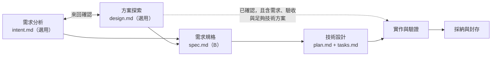

# 驗證紀錄：提案目錄移到 `docs/proposals/` 與六階段流程

- 狀態：文件更新、目錄遷移與 Codex 獨立校閱完成；Final Status 見文末
- 流程：A 直接開發（只改文件與目錄位置；不使用 Spec Kit，不改程式）
- 使用者核准：使用者批准最新的流程設計與目錄變更（由 Codex 轉達）；決策記錄在 [ADR-0005](../../architecture/decisions/0005-proposals-location-and-development-process.md)（Accepted，依使用者本次明確批准）。本紀錄不重寫決策內容。
- baseline-commit：`946a124`。開始時工作目錄**不乾淨**，含上一輪尚未提交的修改；開始時 index 已有 25 個檔案暫存，**暫存的來源未判定**。本次在其上修改，且**沒有動 index**。
- 受影響的 capability：不影響有效規格

## 流程（核准版）

可以省略文件，不能省略實作依據。`intent → spec`、`design → spec` 合理；`intent → 實作` 通常不足；`design → intent` 只是回饋或正式整理，不是必經順序。正本在 [開發流程 §10](../../developer-guide/development-workflows.md#10-工作階段與溝通用詞)。

## 範圍

- 目錄遷移：`docs/architecture/proposals/` → `docs/proposals/`；Tool 範本同樣移動；forge-explorer 原本沒有內容，建立空骨架。
- 新增 ADR-0005；在 ADR-0003、ADR-0004 只加導航註記。
- 手冊 §10 改為六階段（含 Mermaid 流程圖）；§11、§12 對齊「同一角色一份主稿」「凍結被承接的範圍」；§2–§6 的路徑與「正式 Intent 選用」。
- Policy：POL-SPECKIT-001 R4 步驟 4、POL-SPEC-001 三層表與封存結構、POL-DOC-001、POL-DOD-001 的位置。
- 導覽、AGENTS、README、範本、worktree 指引、遷移狀態、tooling 說明的路徑與連結。
- `saintber-design` 的 README、`tooling/skills/README.md`。

**不在範圍**：`saintber-design` 的 SKILL 正本、部署器、代理入口與測試（由 Codex 負責）；程式碼（包括 `archive.mjs`）；憲章；已採納的 ADR-0001、0002 正文；設計快照；`archive/`；有效規格；新的業務規格；Spec Kit 擴充功能（已知限制不變）。

## 遷移映射

| 舊位置 | 新位置 | 方式 |
|---|---|---|
| `docs/architecture/proposals/`（8 個檔案） | `docs/proposals/` | `mv`（只動工作目錄，不經 git） |
| `tooling/scaffold/project/docs/architecture/proposals/`（2 個檔案） | `tooling/scaffold/project/docs/proposals/` | `mv` |
| （無） | `projects/forge-explorer/docs/proposals/.gitkeep` | 新建空骨架 |

移動前：驗證來源與目標的絕對路徑都在本 repo 內、目標**不存在**（不覆蓋）、來源不是 symlink。保留 topic 名稱、狀態、JSON 附件與歷史正文。

被移動的檔案：`README.md`、`development-phase-terminology/verification.md`、`development-workflow-granularity/verification.md`、`exploration-conversion-tracking/verification.md`、`forge-design-delivery/verification.md`、`speckit-extension-design.md`、`task-team-config.example.json`、`task-team-design.md`；範本的 `README.md`、`_template.md`。

- `docs/proposals/speckit-extension-design.md` 第 79 行是該提案描述「自己放在哪裡」的一句導航文字，我只把位置改為新路徑並註明原位置；提案的設計內容與其他正文沒有改。

**歷史中的舊路徑**（已採納 ADR-0003 的表格、先前的驗證紀錄內文）保持原樣，那是當時的事實；舊路徑與新位置的對應以 ADR-0005 的映射為準。這些歷史文字不是現行需求。

## 檢查結果

### 搬移

- 移動前後逐檔雜湊比對：**10／10 內容完全相同**（移動本身沒有改任何位元組）。
- 搬移後 `docs/architecture/` 只剩 `README.md`、`decisions/`、`overview.md`。
- 我的操作前後，`git ls-files -s` 的雜湊相同（`daaf7f75…`），**沒有改 index**；沒有 `git add`、`commit`、`reset`、`stash`。

### 連結

- 相對連結改寫：搬移後以腳本依「檔案搬移前的位置」解析每個連結目標，目標若被搬移就改指新位置、並重算相對路徑（目錄深度少一層）。共改寫 35 個連結，0 個無法解析。最終的連結與錨點檢查結果見下方「最後檢查」。

### 歷史保持不動

- `archive/`、設計快照、ADR-0001、ADR-0002、`.specify/`：`git status` 沒有任何變更。
- ADR-0003、ADR-0004 只新增導航行（「後續修訂／後續」），正文與決策未改；ADR-0005 沒有標舊 ADR 為 superseded。

### 無條件必建 Intent 的字句

依使用者補充，檢查 Policy、手冊與範本。已改為「正式 Intent 選用」的位置：POL-SPECKIT-001 R4 步驟 4（改為讀**實際存在的**正式 Intent／Decision，沒有時讀記錄的探索稿或需求來源，**不要求必建**）、POL-SPEC-001 三層表與封存結構、手冊 §5.1 目錄與 §5.2 步驟 6–7、`speckit-workflow.md` 的提案／Intent／Decision 表與呼叫範例、Tool 範本 `docs/README.md`。

`archive.mjs` 的 `hasInputs` 本來就支援沒有 `docs/intent/<change>`；本次**沒有改程式**，只讓文件與實作一致。

## 最後檢查

- 全 repo 現行 Markdown 110 份（排除 `archive/`、設計快照、代理入口）：261 個本機連結與章節錨點，**0 個缺檔或錨點不存在**；code fence 0 個問題。
- 搬移前的 10 個檔案，全部仍存在於新位置。
- 現行文件中的舊路徑 `architecture/proposals` 殘留：0 處。（本紀錄的遷移映射表與歷史驗證紀錄、已採納 ADR 的表格刻意保留舊路徑，不算殘留。）
- 可能的「無條件必建 Intent」字句：0 處。
- 手冊 §10 含 Mermaid 流程圖；已刪除「技術設計不是只有設計」的舊敘述；已加入「凍結被承接的範圍」並註明部分承接不能整份凍結。
- POL-SPECKIT-001 R4 步驟 4 已改為讀實際存在的正式 Intent／Decision，沒有時讀記錄的探索稿或需求來源。
- ADR-0005 背景已更正為「ADR-0003 本文只定義 A／B／C」；決策 3 改為引用手冊作為共用規則的正本，技能只是遵循。
- index 雜湊（`git ls-files -s`）前後相同；repo 根目錄沒有 `.tmp-*`；檢查腳本放在系統暫存目錄。
- 檢查方式限制：檢查腳本只驗證連結、錨點與關鍵字，不驗證語意。

## 未執行的項目與限制

- **沒有**實際走一次六階段的範例流程；沒有執行 `saintber-design`、安裝器或其測試（由 Codex 負責）。
- **沒有**跑產品測試、建置或 Spec Kit 擴充的測試：本次沒有改程式。
- **沒有**在 Markdown 或 Mermaid renderer 檢視版面；流程圖只做了語法層面的檢查。
- 語意核對是代理（Claude）比對文字，**不是**人工審閱，也**不是** Codex 的獨立校閱。
- 「無條件必建 Intent」的檢查是關鍵字搜尋加人工閱讀（代理），不保證找出所有語意上的矛盾。
- **早期 `intent.md` 如何確定同 topic**：共用規則（同一角色一份主稿、轉換紀錄、凍結被承接的範圍）已寫在手冊；技能如何判斷同 topic 的細節，依使用者說法由 Codex 在技能中處理，我沒有改 SKILL。

## Docs Consistency（POL-DOD-001 R6a）

- 偏離已核准設計：無。新規則以 ADR-0005 記錄使用者本次的明確批准；沒有改寫既有的 Accepted ADR 正文。
- 不新增產品功能、不寫新的業務規格、不改憲章。

## Codex 獨立校閱與部署核對（2026-10-14）

- 以遷移前快照獨立核對：10 份原有提案／範本均在新位置，舊位置均不存在；JSON 附件與 task-team 草稿內容未變。四份既有驗證紀錄僅改連結目標或換行，未重寫歷史正文。Spec Kit 擴充草稿僅更新所在位置的說明與相對引用，仍待使用者確認。
- 84 份受保護檔案的雜湊比對，僅 ADR-0003、ADR-0004 因新增導航註記不同；已檢視其差異，決策正文未因本次遷移重寫。設計快照、封存與上游技能保持原樣。產品程式、有效規格、憲章及 Spec Kit 工作包沒有本次變更。
- 提交前的 43 份變更 Markdown，208 個本地連結與 23 個章節錨點檢查通過，fence 無缺漏。此為文字與引用檢查，不是 Mermaid 解析器或 renderer 驗收。
- 手冊、ADR-0005、Policy、AGENTS、導覽與範本的語意已交叉校閱；文件樹、同 topic 同角色唯一、合併稿與拆分稿擇一、正式 Intent 選用、承接範圍凍結與正式輸入優先順序等問題已修正，沒有新的使用者待決事項。
- `saintber-design` 正本更新為新目錄與方案探索分工，讀已有需求分析但不改寫它；Hub 與 forge-explorer 的三代理入口已重新部署。部署器 12 項測試通過，來源技能的 `quick_validate.py` 通過。沒有修改部署器／測試程式；測試結果不等於技能的新判斷情境已完成端到端驗收。
- Python `tomllib` 解析兩份 Gemini TOML，四份 Codex／Claude 入口與正本相同，Gemini prompt 與共用來源一致且參數位置只有一個。兩個專案再次安裝，各三入口均 `unchanged`；沒有 Gemini CLI 實機驗收。
- 遷移前後的 index 在校閱期間相同；Claude 未 stage 或 commit。Codex 依使用者先前的提交授權，另行處理這批流程文件、技能交付與遷移的必要提交，不由技能或遷移腳本自動提交。

## Final Status

- **Done，限本次流程文件、提案遷移、技能同步與已列出的校閱／驗證。** Gate A 以文件與部署檢查代替；沒有執行完整六階段範例、新判斷情境的代理端到端驗收或 Gemini CLI 實機驗收，也沒有 renderer 驗收。不擴大功能開發。
