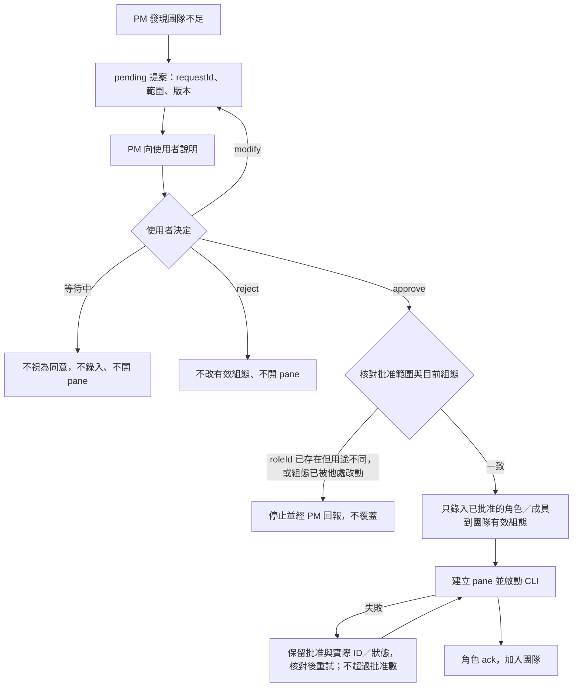
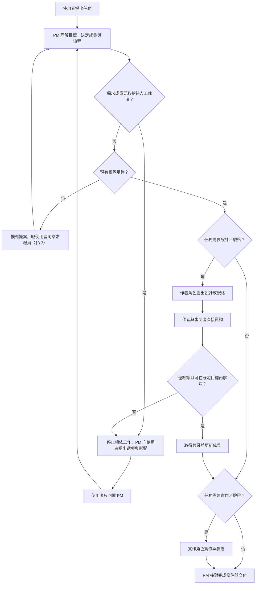
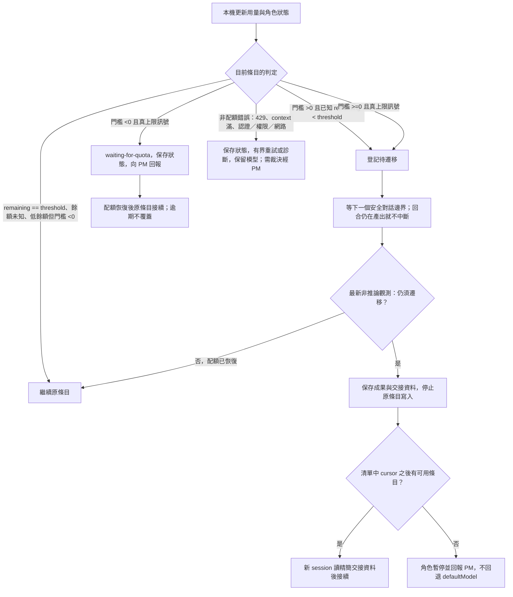
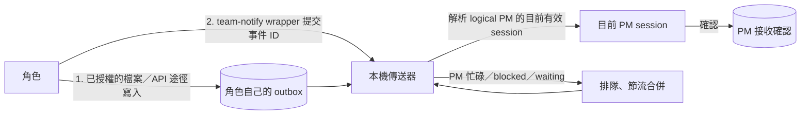

# 按任務啟動 AI 團隊：設計草稿

- 類型：合併稿（需求分析＋方案探索，單檔 `<topic>.md`）
- 狀態：**已實作並已採納（結案，待提交）**（A 直接開發；設計經使用者同意作為實作基準，2026-10-14）。驗證範圍與限制見第四輪 Verification Record；有效規格為 [`docs/specifications/task-team/spec.md`](../specifications/task-team/spec.md)。提交由 Codex 依使用者授權處理
- Owner：Hub（本次實作落地為 repo 開發工具 `tooling/team/`＋`tooling/skills/task-team/`，見 §2；不建立 project、不做 npm 產品化）
- 使用者來源：2026-10-07 初稿需求；2026-10-14 使用者對模型組態、餘額門檻、PM 對口、主動回報、回報權限與流程中立的修正，以及同日追加的「角色可擴充」需求（經 Codex 協調轉述，見「需求修訂紀錄」）
- 本次修訂基線：HEAD `0656d61`。本次整體設計修訂最初開始時 Git 乾淨；角色擴充修訂開始時，前輪對本稿、JSON 附件與 README 三份文件的修訂**尚未提交**，予以保留。前幾輪（模型、回報、角色擴充）只修訂設計文件與 JSON 附件；實作輪（2026-10-14 起）依 §11 新增 `tooling/team/` 與 `tooling/skills/task-team/`
- 目前決策：只有 §9「已裁決事項」的八項行為是使用者已裁決（2026-10-14 指示）；其他介面、欄位名稱、數值與流程細節仍是探索中的草案。Q1 已於實作授權內落地為 Hub 開發工具（§2）
- 本次範圍：實作 §11 技術方案（team CLI、核心模組、測試、task-team skill 三入口）、Pane／Space／Tab 規則（§3.4）；以及已同意的可配置角色與擴充、模型組態與門檻語意、PM 對口、主動回報與逾期診斷、回報權限、流程中立的任務流程
- 尚未實作／未驗證：Gemini 實機與用量 adapter、Claude 公司 Azure 的數字額度、三個 CLI 對技能的端對端載入與遵循、`quotaRemainingPercent` 以外的 metric；實機證據只涵蓋第四輪列出的範圍

這份文件是設計與驗證歷史，不是 Policy 或有效規格（有效規格見上）。初始角色／模型組態見 [task-team-config.example.json](task-team-config.example.json)，它是可供 `tooling/team` 的 CLI 載入的示例組態（複製後修改；欄位名稱仍可能調整，數值只是初始例）。

## 1. 建議交付形式

採用 **skill + Node command**，但只有一份協作規則正本：

- `task-team` skill：說明何時啟動團隊、PM 怎麼組隊、角色互相審閱、主動回報與人工裁決流程。
- Node command：讀組態、驗證環境、建立 Herdr pane、啟動 CLI、保存狀態、觀測用量、傳送角色事件與執行交接。
- command 啟動 PM 時，把同一份 skill 與角色說明位置交給 PM；從 skill 啟動也呼叫同一 command，不另寫第二套規則。
- Claude 與 Codex 的技能部署由安裝腳本從正本產生／複製，不人工維護兩份邏輯。

預期操作介面（**尚不可使用**）：

```text
node <team-command> start --task-file <任務文件> --cwd <工作目錄>
node <team-command> status --team <id>
node <team-command> watch --team <id>
node <team-command> decide --team <id> --request <id> --answer-file <決策文件>
node <team-command> check-transport --team <id>     # 不用模型 token 的傳輸檢查
```

`start` 預設只啟動一位 PM。PM 理解任務後，從已啟用的組態角色決定需要哪些成員、先後與可併行的工作；任務中追加成員需使用者同意（§3.3）。`--dry-run`／`plan` 提供實際 pane 與 CLI 變更之前的檢視，純離線模式不讀取 Herdr，也不產生推論費用。

## 2. 歸屬（Q1，本次實作落地）

| 選項 | skill 正本與 command | 治理 |
|---|---|---|
| 開發輔助工具 | `tooling/skills/task-team/`、`tooling/team/`；組態在 `tooling/team/config/` | Hub 治理 |
| 可安裝產品 | 現有規劃中的 AI 工具集，優先討論 `projects/ai-assistant/` 的團隊能力 | 先確立其目的與自己的治理 |

**本次落地**：採「開發輔助工具」：`tooling/team/`（command、核心、組態、測試）與 `tooling/skills/task-team/`（skill 正本與安裝器）。來源是 Codex 在使用者本次實作授權（2026-10-14「實作 skill／Scripts，兼容 Codex／Claude／Gemini」）內的判斷，**不是**使用者逐字裁決；未來若要產品化，另開 topic。

不建立獨立 `herdr` 或 `task-team` project。Node.js 是實作技術，不單靠語言把 AI 協調能力歸入 Node.js 工具集。既有 `tooling/herdr/grid.cjs` 是版面 adapter 的相依；產品化時要處理公開呼叫與部署方式，不能讓 Tool 任意匯入 Hub 內部程式。

## 3. 可配置角色與擴充

### 3.1 角色定義

角色是**開放的組態定義**，不在程式或 skill 以固定清單寫死。每個 `roles.<roleId>` 錄入：

| 欄位（草案名稱） | 內容 |
|---|---|
| `displayName` | 顯示名稱 |
| `purpose` | 一句話目的 |
| `responsibilities` | 職責條列 |
| `instructions` | **只放該角色專屬**的工作指示 |
| `deliverables` | 預期成果 |
| `enabled` | 是否可被選用 |
| `models` | 該角色的有序模型條目（§6） |

- 新增任意 `roleId` 不需改程式或 skill；啟動器以同一個 adapter 與 prompt 生成流程，把角色欄位當作給 AI 閱讀的資料帶入，**不拼成 shell 指令**。
- 共通規則（協作、模型、裁決、回報、權限、PM 唯一對口）只在 skill 寫一份。角色 `instructions` 不得覆寫使用者裁決、治理、PM 唯一或模型清單等共通約束；兩者衝突時以共通規則為準，並回報 PM。
- 欄位名稱是草案，不代表 runtime 已存在。

初始**示例**角色（實際內容錄在 [JSON 附件](task-team-config.example.json)，不是完整允許清單）：

| 角色 | 責任摘要 |
|---|---|
| PM | 理解目標、決定成員與派工、協調依賴、**唯一使用者對口**、彙整裁決、驗收交付 |
| SA1 | 需求分析、總體方向；任務需要時撰寫需求說明或規格 |
| SA2 | 獨立審閱 SA1 的成果，直接質詢 SA1 |
| SD1 | 任務需要時的具體設計：界面、資料流、技術方案 |
| SD2 | 獨立審閱 SD1 |
| PG | 依已確立的成果實作、驗證與回報 |
| QA（停用示例） | 未啟用的可編輯擴充示例，不是已批准的成員 |

同一 AI 品牌可以擔任不同角色；獨立審閱至少使用不同 session。作者與自己的獨立審閱者不得由同一成員擔任。

### 3.2 PM 與成員

- **PM 唯一，ID 可配置**：`coordination.pmRoleId` 指向 `roles` 中一個啟用、有效的定義；指向不存在或停用的角色是組態錯誤。不得移除或停用目前有效的 PM 而假裝團隊仍在運作。
- **角色定義與成員分開**：角色定義是 `roleId`；團隊成員是 `memberId + roleId + paneId`。成員沿用其角色的模型清單，增加 pane 不是另一套模型偏好。
- **初始組隊**：依使用者啟動任務的授權，PM 從**已啟用**的組態角色選出所需成員（維持既有規則）。
- **追加**：任務進行中，PM 發現現有團隊不足時，無論是新角色，或為已存在的角色增派第二位成員，**一律先提案、取得使用者同意**（§3.3）。

**PM 的權限邊界**：PM 可決定派工、流程與順序，並可**提議**新角色或增派成員；**不得**自行啟用角色、寫入有效 `roles`、先開 pane 再請使用者追認，也不得自行修改模型清單、順序或門檻，不能因任務困難自行升級到其他模型（例如 Opus），也不能因配額未知自行加上人工核准關卡。模型只由 §6 的組態規則決定。

PM 的兩種入口：command 可啟動新 PM；skill 可在合適時由目前 session 擔任 PM。若目前 session 的 provider／model 不在 PM 的有效清單，或不是清單規則目前會選到的條目，必須先按組態安排 PM，不能以「目前已在某個 CLI」跳過組態。PM 是否另外開 pane 不改變其唯一協調責任。

### 3.3 擴充提案與批准

PM 的提案至少包含：

- 問題／缺口，以及為何現有角色或成員不能兼任；
- 職責與預期成果（新角色要附完整角色定義）；
- 要增加的 `roleId`、成員數與 pane 數；
- 模型有序清單與逐條門檻；沒設模型時明示採用 `defaultModel`；
- 預期用量與對時程的影響，不知道就標「未知」，不編造 USD；
- 必要的工作目錄或權限變更及其影響。新增角色不等於授權放寬權限或修改模型。



- 修改後的提案依新內容重新確認；舊提案的同意不授權修改後的範圍。
- 批准紀錄（本機紀錄即可，不依賴任何特定工作流程）包含：`requestId`、提案範圍或版本、使用者決策來源、批准的角色／成員數／pane 數，以及是否允許寫回共用組態。
- **只套用批准的內容**：這不是 PM 任意修改組態的例外；既有角色的模型清單與門檻不變。
- **寫回範圍**：任務內的批准只存入該團隊的有效組態與決策快照，不自動修改使用者的全域或共用組態。要永久加入共用組態，需使用者明示同意，且只新增已批准的內容。
- **重試安全**：批准角色不等於 pane 已啟動。pane／CLI 啟動失敗時保留批准與已建立的實際 ID／狀態，先核對是否已建立或只缺 ack 再重試；不重複增員、不開出多於批准數量的 pane，相同的已批准內容也不需反覆詢問同意。只處理本次自建的 pane，不動使用者原有的 pane。
- 新增的角色與成員同樣套用模型門檻、主動回報、逾期、權限診斷與流程中立規則。

### 3.4 Pane、Space 與 Tab

使用者 2026-10-14 追加：開團隊或加成員的 pane 必須呼叫既有 `tooling/herdr/grid.cjs`；Space 依使用者明示或目前 Space；Tab 依明示或依任務名新增；Pane 依角色任務命名。

- **Space**：使用者明示（ID 或名稱）優先；未指定時用呼叫端自己的 Herdr context（`HERDR_WORKSPACE_ID`），不從其他人的焦點猜測。明示的 Space 不存在就報錯，不退回其他 Space。
- **Tab**：明示（ID 或名稱）且存在就使用；明示但不存在就報錯。未指定時以任務名 `tab create --no-focus` 新增，記錄 tab 與 API 自帶的 root pane（anchor）為本團隊所有。
- **Pane**：所有角色 pane（含 PM）都以 `grid.cjs split --tab <ws>:<tab> --cwd <dir> --name <名稱>` 新增，不另寫分割演算法；從 grid 輸出的尾端 JSON 取 `new_pane_id`，之後只用回傳的實際 ID。名稱含角色與任務（可含 model）。
- **anchor 清理**：只有本團隊新建、仍是空 shell 的 anchor，才在 PM pane 成功建立後關閉；使用者既有 pane 一律不動。
- **追加成員**沿用本團隊的 Space／Tab，不每次新增 tab。
- **恢復**：失敗時已保存 tab／anchor／pane／agent 啟動狀態，再次呼叫依記錄恢復，不多開 pane。啟動 agent 前確認 pane 是空 shell，啟動後看實際 agent 與 session；timeout／stalled 不是「未送出」的證據，不盲目重送。
- 任務與角色文字以 argv 傳遞或經 `agent prompt` 參數送出，不拼 shell 字串。

## 4. 任務流程（流程中立）

任務**不一定**使用特定工作流程，也不一定產生規格。主幹只描述：

1. **任務輸入**：使用者提供的目標、限制與相關文件。
2. **設計／規格**：任務有需要才有；形式依任務而定（直接設計稿、需求說明、或選用工作流程的產物）。
3. **審閱**：作者成果由獨立審閱者質詢。
4. **實作／驗證**：任務有需要才有。
5. **成果**：PM 核對完成條件並交付使用者。



圖中角色名稱依組態而定（例如示例中的 SA1／SD1／PG）。角色每一步的進展、阻礙與完成都**主動**回報 PM（§7），圖中省略。

### 4.1 選用工作流程

依任務性質或使用者選擇，可採用專案既有的開發流程（見 [開發流程：三種顆粒度](../developer-guide/development-workflows.md)）。組隊**不預設**任何一種流程，也不預設探索完成就一定建立 change。

使用者或任務選擇 Spec Kit 時（流程 B），才產生 spec／plan／tasks 工作包；即使採用 Spec Kit，正式 Intent（`docs/intent/<NNN-name>/`）仍是選用，不是必須另外建立一份（依 [開發流程](../developer-guide/development-workflows.md) 與 AGENTS.md）。使用時：由責任角色先載入目標專案的 context、憲章、Policy 與有效規格，報錯就停止，不換到另一個專案繞過；工作包建在擁有能力的專案中，不由 PM 全部塞到 Hub `specs/`。這些產物只在選用 Spec Kit 時存在，不是所有任務的必備項。

流程與模型選擇互相獨立：採用哪一種流程不改變 §6 的模型規則。審閱角色以讀取及議題回覆為主，作者負責修改同一份文件。多人實作可分 worktree；使用者未要求新 topology 時不擅自建立 workspace／tab／worktree。

## 5. 協作、對口與人工裁決

- **使用者只和 PM 溝通**。使用者不需要主動插手各角色 pane；各角色需要人工裁決的事項都交給 PM 轉述。
- 子角色**不得**自己對使用者發出 AskUserQuestion 或等同的提問。PM 彙整問題、選項、建議與影響後向使用者提出，取得答案後回傳給正確角色。
- **角色不足也由 PM 提出**：追加角色或成員依 §3.3 由 PM 向使用者提案。
- **可直接討論**：作者與其審閱者（例如示例中的 SA2↔SA1、SD2↔SD1）可在既定目標內直接來回質詢，PM 不必逐句轉傳；但角色要主動把議題結論、未決項目、阻礙、裁決需求、里程碑、完成報告與交接資料通知 PM。討論以議題 ID、引用段落與精簡差異進行，不把完整對話重複貼給每個人。
- **可自行協調**：既定目標內的文字澄清、邊界案例補齊、錯誤修正、等價實作細節。**交由使用者（經 PM）**：需求目的不明、改變範圍／公開契約／治理、對使用體驗或維護成本有重要差異的方案、較佳替代方案、超出既有授權或預算。不能因兩位 AI 同意就代替使用者裁決。
- 待裁決時 PM 保存問題、選項、建議及影響；停止依賴該決策的派工，已在跑的相依工作於安全點暫停。只有明確與該決策無關的工作可繼續。使用者未回答不能視為同意；禁止代答 agent 權限／信任對話。
- 組態可限制單一議題的討論輪數，初始示例三輪；仍未收斂就回報 PM 爭點，不能因達到輪數而假裝共識。

## 6. 模型組態與餘額門檻

### 6.1 組態結構

模型**完全由組態決定**，PM 不依偏好或難度自由挑選。組態欄位：

- `providers.<id>`：全域 `enabled`，以及 CLI、認證方式、用量來源、quota pool 等 metadata；**不存** key、token 或公司 endpoint 秘密。
- `defaultModel`：一個完整條目。
- `roles.<role>.models`：該角色自己的**有序**條目清單。

每個條目都是完整物件，不引用共享 profile：

```json
{ "provider": "claude", "model": "azure_ai/claude-sonnet-5-5[1m]", "enabled": true,
  "remainingThreshold": { "metric": "quotaRemainingPercent", "value": 0 } }
```

- 門檻屬於**條目**，不在角色或 provider 之間共享。同一 provider／model 出現在 SA1 與 SA2 時，可以設不同 `value`。
- 示例 `metric` 為 `quotaRemainingPercent`；其他單位與各 provider adapter 的支援範圍留待技術設計，本稿不把此單位定為唯一定案。
- 示例組態中的數值只是可編輯的初始值，逐條可改，不是公司／個人的全域門檻：示例中 Claude 條目多為 `0`，Codex 條目為 `50` 或 `70`（SA1 與 SA2 的同一個 `gpt-6.1-sol` 條目分別為 `50`、`70`，示範門檻不共享）；Gemini provider 與其條目停用。Claude model 識別碼用公司 API 實際接受的技術 id（`azure_ai/claude-*`，保留家族、順序、門檻與 `[1m]` 後綴）；初稿曾寫成 `azuer_ai/...`，經真實 API 回覆的允許清單核對後更正，這是**技術識別碼的修正，不是模型政策翻案**，執行期沒有內建 alias 或 fallback。演算法沒有公司或品牌偏好，順序完全依清單。
- 負門檻例：`"remainingThreshold": { "metric": "quotaRemainingPercent", "value": -1 }`。意思**不是**「接近上限就暫停」：低餘額或未知時照常工作，只有收到真上限訊號才進入 `waiting-for-quota`，且不換到下一個條目（§6.4）。
- `metric`、`value` 的實際欄位與單位支援尚未實作；除 `quotaRemainingPercent` 示例外，其他單位與 adapter 對照留待技術設計。

### 6.2 有效清單

| 角色組態 | 有效清單 |
|---|---|
| 角色未定義於 `roles` | **不可啟動**，也不用 `defaultModel`；須先依 §3.3 取得同意並錄入職責定義 |
| 角色 `enabled: false` | **不可啟動**，不因 `models: []` 改用 `defaultModel` |
| 已定義且啟用，沒有 `models` 欄位或 `models: []` | 複製 `defaultModel` 為唯一條目（門檻隨條目獨立複製，不共享 profile） |
| 非空清單 | 就是該清單；**不會**因下列情況回退 `defaultModel`：全部停用、全部低於門檻／耗盡、沒有可啟動候選 |
| 非空清單中有條目缺 `provider` 或 `model`、或格式錯誤 | **組態錯誤**：啟動前驗證失敗並回報，不當作「沒有模型」而改用預設 |

「沒有設定」只指**已定義且啟用的角色**缺 `models` 欄位或空陣列，不是「沒有額度」，也不是「角色不存在」。`defaultModel` 同樣遵守 provider／條目 `enabled` 與自己的門檻；它是唯一候選又耗盡、沒有下一個條目時，該角色暫停並回報 PM，不從其他角色的清單借模型。

### 6.3 選擇規則

正常情況選有效清單中**第一個**同時符合下列條件的條目，之後依原順序往下：

1. 條目與其 provider 都 `enabled`；
2. 可啟動：CLI、認證與 adapter 可用（啟動前驗證）。這只看「能不能啟動」，**配額耗盡不算不可啟動**；
3. 依該條目自己的門檻判定（§6.4）：
   - `>= 0`：未被判定為須遷移或已達真上限才選；否則跳到下一個條目。
   - `< 0`：**不因配額跳過**。即使首次選擇時已知配額耗盡，仍選定這個條目並進入 `waiting-for-quota`，不往後找。

- **cursor 只往後**：同一任務中，角色的條目 cursor 只依清單往後移，不回到已遷移離開的條目；未知配額或全部不可用時也不回退 `defaultModel`。在安全邊界真正切換前，可用最新的**非推論**觀測（例如 adapter 讀到的配額視窗）再核對一次：配額已 reset 恢復時，不因過期的「待遷移」登記而錯切。新任務如何重新初始化 cursor，以及已耗盡條目的冷卻／恢復紀錄留待技術設計；這不改變本任務內切換只往後。
- 允許依清單順序**自動跨供應商**（使用者本次指定），不需每次切換另行詢問。
- **金額上限**（選用）超過時只能暫停並經 PM 回報，不能成為另一個偷偷換模型的選擇器，也不覆蓋 §6.4 的餘額語意。
- 相同 quota pool 的不同 model 不代表新的配額：確知某 pool 已耗盡時，略過同 pool 中門檻 `>= 0` 的候選；門檻 `< 0` 的條目仍照上面規則選定並等待。
- **CLI 內建 fallback**：部分 CLI 有自動換模型的功能（例如 Claude CLI 的 `--fallback-model`，在預設模型過載或不可用時改用指定模型）。adapter 不啟用與角色清單不一致的 CLI 自動 fallback；啟動後由 adapter 核對實際使用的 model，與組態條目不符就回報 PM，不能靜默偏離組態。各 CLI 的實際行為由 adapter 在技術設計時確認。

### 6.4 門檻語意

觸發判定只用兩種「真上限訊號」與「已知低於門檻」：

- **真上限訊號**：provider 明確回報 quota-exhausted；或可靠配額資料已知 `remaining = 0`、`used = 100%`、hard limit reached。不必為了取得錯誤而故意多送一次推論。
- **不是**真上限訊號：context 滿、短暫速率限制（例如 429 rate limit）、認證／權限錯誤、網路錯誤。這些不觸發配額換模型，但**也不代表可以直接正常工作**：保存狀態，做有界重試或診斷，保留目前模型；需要裁決的經 PM 處理。

**觀測範圍**（以示例 `quotaRemainingPercent` 說明）：

- provider 有多個**確實約束該條目**的配額視窗（例如不同時間長度的 limit）時，取其中 remaining 最少者判定。
- 缺少 model 與 pool／視窗的對照、或缺少數值時，視為**未知**（依使用者規則照常可用到實際上限），不改成停止。
- 不能拿 context 使用量或估計 USD 冒充 `quotaRemainingPercent`。

| 門檻 | 可觀測餘額 | 無法觀測餘額（未知） |
|---|---|---|
| `> 0` | 已知 `remaining < threshold`（**嚴格小於**）時登記「待遷移」，在下一個安全對話邊界切到下一個條目；`remaining == threshold` 尚未低於門檻，**不觸發** | 沒有可靠數值可判定，視為可用到實際上限；收到真上限訊號才切 |
| `= 0` | 收到真上限訊號（含可靠資料已知 remaining=0／used=100%）才切到下一個條目 | 同左，等真上限訊號 |
| `< 0` | **不限制**：低餘額、接近上限或 AI 提示接近上限時**照常繼續**；只有收到真上限訊號才進入 `waiting-for-quota`，留在原模型等加值／配額恢復後接續，不主動更換 | 照常繼續；收到真上限訊號才 `waiting-for-quota` |

- 無法偵測餘額時，**不**一開始就把條目視為已達上限或因未知而停止；`>= 0` 視為可用到實際上限，`< 0` 仍不切換。
- **安全對話邊界**：所有配額切換（包括可靠資料已知 remaining=0）都遵守。目前回合仍在產出時只登記，不擅自中斷；回合完成、成果保存後才切換。若 provider 已拒絕下一個請求而無法繼續，保存可取得的成果後再交接。
- 不為了試探配額而發出額外推論。
- `waiting-for-quota` 不靠逾期改模型：§7 的逾期只做診斷，不能覆蓋負門檻。配額恢復後由原條目接續。永久等待時，使用者可主動修改組態或處置。

### 6.5 用量觀測

| 資料 | 用途 | 不代表什麼 |
|---|---|---|
| context 使用量 | 判斷是否需壓縮／checkpoint／新 session | 不代表訂閱剩餘配額，不是真上限訊號 |
| 帳號配額視窗 | 門檻判定、耗盡與 reset 時間 | 不一定能換算成剩餘 token |
| session token／估計成本 | 選用金額上限與成本觀察 | 不等於 Azure 最終帳單 |

- 以本機 script 定期讀取用量（示例 60 秒，可配置），不讓 AI 回覆「還剩多少」。觀測記錄含來源、時間、範圍、可靠性與未知欄位；過期資料不能作為「已知 remaining」，只能當未知處理。
- Codex 官方提供 `account/rateLimits/read`，可取得各 limit 的視窗、百分比與 reset 時間；以實際回傳的 pool 判定，不能挑一個看起來還有額度的 pool 就宣稱全部可用。[官方 App Server 文件](https://learn.chatgpt.com/docs/app-server)
- Claude status line 提供 context、token、估計 session USD；rate limit 欄位可能缺失，缺失就是「未知」。估計成本依 CLI 價目計算，使用自訂 Azure model ID 時要確認計價來源。[Claude status line](https://code.claude.com/docs/en/statusline)、[Microsoft Foundry 計費](https://learn.microsoft.com/en-us/azure/foundry/foundry-models/concepts/claude-models-billing)
- Gemini 預設停用；官方 `/stats model` 不證明有穩定的非互動機讀接口。啟用前驗證 adapter 與帳號可用模型，不自行安裝、登入、升級或切成付費 API Key。[Gemini quota 文件](https://geminicli.com/docs/resources/quota-and-pricing/)
- 本機規則只管理本工具建立的團隊，無法阻止帳號在其他工具消耗；門檻是調度規則，不是供應商的硬隔離。不使用額外付費 credits、API Key fallback 或解除停用來繞過。

### 6.6 遷移與交接



provider 已拒絕下一個請求而無法等待邊界時，視為已到邊界：保存可取得的成果後進入 Recheck。

Recheck 時，只有可靠的恢復／reset 證據可以取消待遷移。若先前已有真上限訊號，之後觀測變成未知或缺失，不能抹掉該訊號而恢復派工，直到有恢復證據為止。「未知可繼續」的規則只適用於未曾確知耗盡的情況。不為了取得證據而送出浪費 token 的探測。

- 候選的失敗狀態要有冷卻／reset 機制；切換不能再選回同一個已耗盡的條目或 pool。
- 交接保存：目標、適用治理、目前成果、已完成項目、剩餘工作、Git 差異／worktree、驗證結果、未決議題與使用者裁決；不把整份舊 transcript 全貼。原作者確認停止寫入後才交接，不能兩者同時寫相同範圍。
- **PM 也適用自己的有效清單與門檻**。PM 的條目依規則遷移時，指定下一位 PM 前撤銷舊 PM 派工權。PM 為負門檻且進入 `waiting-for-quota` 時，watcher **不得擅自替換 PM**、不另造裁決者；watcher 只在 PM 對口位置（同一 pane 或狀態輸出）顯示「等待配額」，並保存期間收到的角色事件，待 PM 恢復後投遞。

## 7. 主動回報與逾期診斷

### 7.1 事件與傳送

角色**主動**回報 PM，不等 PM 輪詢。事件類型：`ack`、`progress`、`blocked`、`decision-needed`、`milestone`、`completed`、`handoff`、`waiting-for-quota`。



- **兩段式**：角色**先**用獨立且已授權的檔案／API 途徑把事件存入自己的 outbox，**再**執行 team-notify wrapper 提交該事件 ID。wrapper 只負責提交，不負責保存；所以 wrapper 被擋時，已存入的事件仍在 outbox，可由傳送器或 watcher 找到。部署時兩種能力分別驗證。
- **耐用 outbox**：每筆事件含事件 ID、團隊 ID、角色、任務 ID、事件類型、摘要、成果路徑與時間。
- **outbox 寫入也被擋**：不能聲稱事件已保存。本機 watcher 從「無 ack／無事件」與 pane 狀態辨識 permission blocked，在 PM 對口回報診斷；先排除最小權限問題，不盲目重派任務。
- **目標是 logical PM**：傳送器投遞時解析團隊目前有效的 PM session，不永遠綁定舊 PM pane；PM 交接後，待發事件送到新 PM。
- **兩種狀態分開**：`sent`（傳送器送出）與 `received`（PM 實際接收並確認）。`herdr agent prompt` 結束碼 0 只代表送出，不代表 PM 已收到；角色 pane 仍有輸出也不代表 PM 已收到回報。
- PM 忙碌或 blocked 時排隊，採**節流合併**（同一角色的多筆 progress 合併成一次投遞），不讓每次心跳觸發一次 AI 回合。合併只針對 progress；`completed`、`decision-needed`、`blocked`、`handoff` 等事件逐筆保留，不能因合併而遺失。
- 有限重試、事件 ID 去重、傳送器重啟後由 outbox 恢復。timeout／stalled 時不盲目重送原工作指派。
- 一般靠事件與等待機制，PM 不頻繁讀 pane。傳送器在本機輪詢 outbox 不等於 PM 用 AI 輪詢。

### 7.2 回報期限

PM 派工時為該任務設定回報期限（示例，全部可改）：

| 期限 | 示例 | 計時起點 | 由什麼重設 |
|---|---|---|---|
| `ackSeconds` | 60 | 指派送出（`sent`） | 收到角色 `ack` 即滿足 |
| `progressSeconds` | 300 | `ack`，之後為上一次 `progress` | 角色的 `progress`、`milestone` |
| `hardNoReportSeconds` | 900 | 指派送出，之後為上一次**實質回報** | 只有角色的 `progress`（含具體進展）、`milestone`、`blocked`、`decision-needed`、`completed`，或 PM 明確延長 |

狀態順序：`sent → acked → working → progress… → completed`。本機 heartbeat、用量更新、pane 有輸出都**不能**重設 hard 期限。真正長的工作須由 PM 明確延長，或由角色交付進展；不自動無限展延。

回報計時與重設由本機控制器依已驗證的角色 outbox 事件與其接收時間判定，不依 PM 何時有空處理或確認 `received`；PM 投遞排隊不等於角色未回報。heartbeat 照樣不能刷新 hard 期限。正常完成也須 PM 確認成果才能交付，不把 outbox 的 `completed` 自動當作驗收通過。

### 7.3 逾期與 blocked 診斷

- 逾期時做**一次有界診斷**（`herdr` 讀取 pane 狀態／最近輸出、outbox 與用量記錄），區分：尚未接受、工作中但未回報、權限 blocked、通知失敗、`waiting-for-quota`、崩潰。
- 發現 blocked（例如權限對話）立即診斷，不等滿 hard 期限；相依工作停止派工。
- 逾期不等於死亡：不因此中斷仍在工作的角色，也不因此改模型；負門檻的 `waiting-for-quota` 不被逾期覆蓋。
- 診斷結果由 PM 決定後續（延長、重新指派、請使用者處理權限）；需要人工的事項由 PM 轉述。

## 8. 回報權限

權限不是「在 prompt 叫角色忽略」。官方規則：deny／ask 優先於 allow，allow 不能覆蓋企業或使用者的 deny／ask。[Permissions](https://code.claude.com/docs/en/permissions)、[CLI reference](https://code.claude.com/docs/en/cli-reference)

- **部署時檢查**實際 CLI 的工具與權限層級，回報每個 adapter 的能力（能否以啟動參數增補、是否有可用的受限訊息工具）。
- **建議做法**：啟動該角色 session 時，用 `--allowedTools`／`--settings` 只增補最小的回報權限——允許寫入**自己的 outbox**（檔案／API 途徑），以及執行**固定路徑的 team-notify wrapper** 提交事件（§7.1 兩段式）；或透過既有可用的受限訊息工具。
- **不做**：全面允許 Bash 或 `herdr *`、`bypassPermissions`、覆寫企業 deny／ask、替角色送出核准按鍵、修改全域設定。
- **wrapper**：放在可信固定路徑，角色不能改寫；校驗團隊 ID、目標 PM 與參數，只允許本團隊的回報事件，不能藉這條窄 allow 傳任意 herdr 命令。
- **既有 session**無法更改啟動參數時：改用已授權的 adapter 或待發事件 relay（角色寫 outbox，由本機傳送器代送），或由 PM 請使用者加上精確規則。規則的實際字串格式（含 Windows／PowerShell 環境）**由實作時的平台實測確定**，本稿不宣稱任何規則已驗證。
- **驗證**：部署時分別驗證「寫入 outbox」與「執行 wrapper」兩種能力；正式部署先做不用模型 token 的傳輸檢查（`check-transport`）；但端到端的 AI 權限是否通過，仍需真 CLI 測試，不能把本機探測當作權限驗收。
- **新增角色或成員**沿用同一套最小權限，不因擴充而放寬權限；需要額外工作目錄或權限時，在擴充提案中列出影響，由使用者另行同意（§3.3）。
- **需要人工時**：PM 向使用者說明症狀（例如回報指令出現權限對話或被拒）、所需最小規則、設定位置（當次 session 啟動參數或設定檔）、生效方式與驗證方法。原 pane 的權限對話無法中央處理時，由使用者明確主動接手，不冒充可自動授權。

## 9. 已裁決事項與待決

### 已裁決（使用者 2026-10-14）

下列八項行為是使用者已裁決；條文中的介面、欄位與示例數值仍可在技術設計中調整。

1. 模型完全依組態；各角色有自己的有序條目清單（§6.1）。
2. `defaultModel` 只在角色未設定或清單為空時使用（§6.2）。
3. 每個條目有自己的餘額門檻，`>0`／`=0`／`<0` 與未知配額語意如 §6.4。
4. 使用者只和 PM 溝通，人工裁決由 PM 轉述（§5）。
5. 角色主動回報 PM；有最高逾期與診斷（§7）。
6. 主動處理回報權限，必要時由 PM 提醒使用者設定（§8）。
7. 流程中立：Spec Kit 只是選用流程（§4.1）。
8. 角色可擴充，角色內容錄入組態；PM 覺得現有角色不夠時主動向使用者提出，經使用者同意後才增加 pane／角色（§3）。

上列取代舊 Q2（切到個人訂閱需每次詢問）與舊 Q3（依難度選模型、Sonnet 主力／Haiku 簡單任務／Opus 升級），兩題不再詢問。

### 待決

- 尚無。Q1 已依 §2 於本次實作授權內落地（Codex 判斷，非使用者逐字裁決）。

## 10. 驗收情境

1. 一個任務始終只有一位有效 PM；按任務只啟動需要的成員；使用者只與 PM 對話。
2. **空清單 vs 不可用**：角色無 `models` 或 `[]` 時使用 `defaultModel`；非空清單全部停用、全部耗盡或無可啟動候選時暫停並回報 PM，不回退預設；條目缺 `provider`／`model` 時啟動前報組態錯誤。
3. **defaultModel 耗盡**：唯一候選為 `defaultModel` 且觸發切換、無下一條目時，角色暫停回報 PM，不借用其他角色清單。
4. **同模型不同角色門檻**：SA1 與 SA2 使用相同 provider／model 但門檻不同，同一份用量觀測下各自依自己的門檻判定。
5. **門檻 >0**：已知 `remaining < threshold` 登記待遷移、於安全邊界切換；`remaining == threshold` 不切；未知餘額不提前切，等真上限訊號。
6. **門檻 =0**：provider 回報 quota-exhausted，或可靠資料已知 remaining=0／used=100% 時切換；未知餘額不視為耗盡；不為取得錯誤多送推論。
7. **非上限錯誤**：context 滿、429 短暫速率、認證／權限／網路錯誤不觸發切換，也不視為可直接繼續：保存狀態、有界重試或診斷、保留模型。
8. **負門檻遇真上限 + watchdog**：進入 `waiting-for-quota`，hard 逾期觸發診斷但不換模型；配額恢復後原條目接續。PM 為負門檻時 watcher 不替換 PM，只顯示等待狀態並保存事件。
9. **負門檻低餘額／未知**：門檻 `-1` 的條目在低餘額、接近上限或餘額未知時照常工作，不暫停。
10. **負門檻首次選擇已耗盡**：清單第一個啟用且可啟動的條目門檻為負、已知配額耗盡時，仍選定它並 `waiting-for-quota`，不跳到下一個；配額耗盡不被記為 CLI／認證不可用。
11. **安全邊界與再核對**：回合仍在產出時收到可靠 remaining=0，只登記不中斷；回合完成後以最新非推論觀測核對，若已 reset 恢復則不切換。provider 拒絕下一請求時保存可取得成果後交接。cursor 只往後，不回退 `defaultModel`。
12. **多視窗與冒充指標**：條目受多個配額視窗約束時以最少 remaining 判定；缺 model 與視窗對照時視為未知；context 使用量與估計 USD 不被當成配額。金額上限只暫停回報，不換模型。
13. **CLI 內建 fallback**：adapter 不啟用與清單不一致的 CLI 自動換模型；實際 model 與組態不符時回報 PM。
14. **相同 pool**：確知 pool 耗盡時略過同 pool 的不可用候選；停用的 Gemini 不產生任何呼叫。
15. **PM 忙碌／blocked**：角色事件在 outbox 排隊、節流合併，PM 恢復後依序投遞，事件不重複；`completed`、`decision-needed` 不因合併 progress 而遺失。
16. **PM 交接時有待發事件**：傳送器以 logical PM 解析目標，PM 交接後待發事件送達新 PM，不送往舊 pane。
17. **wrapper 被擋但 outbox 已保存**：角色已用授權途徑存入 outbox，執行 team-notify wrapper 被權限擋下；事件仍在 outbox，傳送器或 watcher 可找到，診斷辨識為權限 blocked，由 PM 向使用者說明最小規則；不繞過 deny。
18. **outbox 寫入也被擋**：沒有事件可投遞，系統不聲稱已保存；watcher 依無 ack 與 pane 狀態辨識 permission blocked，在 PM 對口回報；先排除最小權限問題，不盲目重派任務。
19. **通知 timeout**：`herdr agent prompt` 送出但 PM 未確認時狀態保持 `sent` 而非 `received`；有限重試、ID 去重，不重送原工作指派。
20. **已完成未通知**：角色成果已寫入但通知失敗，逾期診斷從 outbox 與成果路徑辨識「完成但通知失敗」，不重派工作。
21. **heartbeat 不重設期限**：角色只有心跳或用量更新、沒有實質回報時，hard 期限照常到期並診斷。
22. **不使用 Spec Kit 的任務**：只有任務輸入、直接設計、審閱與實作驗證，不產生任何工作包，流程照常完成；選用 Spec Kit 時才在正確專案建立工作包。
23. 在現有 tab 使用 grid 建立 pane、保留焦點、讀取回傳的 pane ID；不操作其他人的 pane。
24. PG 與 PM 遷移均可交接；接手者看到一致狀態，原作者不能與接手者同時寫相同範圍。
25. 指令、skill 與部署副本共用同一套規則。真實 CLI／Herdr 驗收與離線模擬分開記錄；未驗證的 adapter 與權限規則不宣稱已支援。
26. **自訂角色**：組態新增任意 `roleId`（含 `displayName`、`purpose`、`responsibilities`、`instructions`、`deliverables`）時，不改程式／skill 即可依其內容生成職責 prompt；角色內容不被拼成 shell。
27. **PM 可配置且唯一**：`coordination.pmRoleId` 指向的啟用角色成為唯一 PM；指向不存在或停用的角色時報組態錯誤；不能移除或停用目前的 PM 而繼續運作。
28. **未同意／拒絕**：擴充提案在等待或被拒絕時，有效組態不變、不開 pane。
29. **同意後才加**：使用者批准後，只錄入批准的角色，並只開批准數量的 pane；修改後的提案需重新同意。
30. **既有角色增派**：為已存在的角色增派第二位成員，同樣需要提案與同意。
31. **未定義／停用角色**：已啟用的新角色 `models: []` 採用 `defaultModel`；未定義的角色或 `enabled: false` 的角色不能藉 `defaultModel` 啟動。
32. **衝突不覆蓋**：批准的 `roleId` 已存在但用途不同，或組態已被其他來源修改時，停止並經 PM 回報，不覆蓋。
33. **重試不重複**：pane／CLI 啟動失敗後重試相同的已批准內容，不重複增員、不超過批准數，也不重複詢問同意；不動使用者原有的 pane。
34. **instructions 不覆寫共通規則**：角色 `instructions` 寫了「直接問使用者」或「換用其他模型」時，仍以 PM 唯一對口與組態模型清單為準，並回報 PM。
35. **永久寫回需明示**：任務內批准只存入團隊有效組態與決策快照；未明示允許時不寫回共用組態，允許時也只新增已批准內容。

## 11. 技術方案與實作現況（A 直接開發）

實作依據：本稿 §3–§10 與 [JSON 示例](task-team-config.example.json)。不建立 Spec Kit 工作包；產出的團隊也不預設 Spec Kit（§4.1）。下面是**實際完成的 API**（2026-10-15），早稿中沒有實作的模組名（`deadlines.mjs`、`diagnose.mjs`、`providers/*.mjs`、`--state-dir`、`add-member`、`notify` 子命令）已移除。

### 11.1 模組（`tooling/team/`）

| 檔案 | 責任 |
|---|---|
| `lib/config.mjs` | 載入與驗證組態：開放 `roles`、`pmRoleId`、有效模型清單（§6.2）、只接受 `quotaRemainingPercent`、用 `Object.hasOwn` 判定角色與 provider |
| `lib/models.mjs` | 門檻判定（§6.4）、條目選擇與 cursor（§6.3）、pool、待遷移與恢復證據（§6.6） |
| `lib/selection.mjs` | 把真實認證前檢與用量觀測接到條目選擇；停用 provider 不探測；持久化的耗盡 pool 與 `entry.quotaPool` |
| `lib/providers.mjs` | 啟動參數（明確 model、不傳 `--fallback-model`）、認證前檢（只取模式）、Codex 唯讀 `account/rateLimits/read` |
| `lib/limitsignal.mjs` | 從 pane 末端的 provider 錯誤畫面識別 quota 上限；預算類、模型被閘道拒絕（403）、429／529、認證、網路、context 另分類 |
| `lib/team.mjs` | 團隊狀態：成員、擴充提案與批准（§3.3）、派工與期限、遷移、寫入權、checkpoint |
| `lib/controller.mjs` | Herdr 放置與啟動恢復、watcher tick、可重放事件、立即 blocked 診斷、通知、交接、用量套用、單一 watcher owner |
| `lib/lease.mjs` | launch／handoff 的 operation lease：短鎖登記 owner＋nonce，不跨網路持鎖；死 owner 依 journal 恢復 |
| `lib/sender.mjs` | 投遞 journal：`queued → sending → sent → received`，`uncertain` 不盲目重送 |
| `lib/outbox.mjs` | 角色 outbox 與事件驗證（含 `checkpoint` 事件） |
| `lib/herdr.mjs` | Herdr adapter；所有 pane 經 `tooling/herdr/grid.cjs` 新增；agent name 以 team＋member＋hash 產生 |
| `lib/permissions.mjs`、`lib/commandline.mjs` | 最小回報權限（`Edit(//…)`＋固定 notify）與同源的命令列引用 |
| `lib/store.mjs`、`lib/proc.mjs` | 原子寫入與鎖、路徑守衛；argv／無 shell 的子程序與 npm shim 解析 |
| `cli.mjs`、`notify.mjs` | 命令入口；給角色的固定回報入口 |

### 11.2 狀態與持久化

- 團隊目錄預設 `<cwd>/.team/<teamId>/`（`--team-dir` 可指定；本機狀態，不提交）：`state.json`、`outbox/<memberId>/<eventId>.json`、`delivery.json`、`operations.json`、`sessions/`、`watcher.json`、`log.jsonl`。
- 寫入一律暫存檔＋rename；狀態變更在短鎖內同步完成，外呼 Herdr／CLI 不持鎖；跨 await 的 launch／handoff 以 operation lease 保證同一時間只有一個存活 owner。
- 狀態中的重要記錄：`members.<id>.launch`（逐步恢復的步驟與 `startIntent`）、`members.<id>.model`（cursor、`pending`、`waiting-for-quota`）、`members.<id>.checkpoint`、`quotaPools`（持久化的耗盡 pool）、`handoffs`／`handoffHistory`、`appliedEvents`、`approvals`。

### 11.3 命令

`start`（預設啟動唯一 PM 與一個背景 watcher；`--no-watch`、`--dry-run`）、`status`（含 `attention` 與 watcher 狀態）、`members`／`form-done`、`launch`、`propose`／`decide`／`persist`、`assign`／`extend`／`accept`、`event`、`ack`、`resolve`、`tick`、`watch`／`stop-watch`、`usage`、`handoff`、`adopt-tab`、`claim`、`auth`、`check-transport`。完整選項見 `node tooling/team/cli.mjs help` 與 [README](../../tooling/team/README.md)。

### 11.4 Provider adapter

- **Codex**：`codex -m <model>`；`login status` 只取模式，組態要求訂閱時拒絕 API key 模式；用量以 `codex app-server` 的 `account/rateLimits/read` 取確實約束視窗中剩餘最少者。
- **Claude**：`claude --model <model> [--settings <檔>]`，不傳 `--fallback-model`；公司 Azure 沒有數字額度 adapter，缺值為 unknown；真上限由 `limitsignal.mjs` 讀 pane 末端的官方錯誤畫面識別（必須仍是記錄的 session 與 agent 種類）。模型識別碼是公司 API 接受的技術 id（見修訂紀錄 2026-10-15）。
- **Gemini**：`gemini -m <model>`，與其他 provider 同一套規則；停用或未安裝時不探測、不呼叫。**沒有實機、沒有用量 adapter**。
- 所有探測使用 Node 子程序、argv、逾時，不輸出帳號、email 或 token。Herdr 的 agent 資訊沒有 model 欄位，啟動後的 model 記為「未確認」。

### 11.5 回報與權限落地

- 角色先把事件 JSON 寫入自己的 `outbox/<memberId>/`，再執行固定 notify 提交已存在的事件 id；事件格式與最小有效範例在 SKILL。
- Claude 角色啟動時以 `--settings` 增補最小 allow：`Edit(//…/outbox/<member>/**)`（官方文件指出路徑規則只認 `Edit`／`Read`，`Write(...)` 不會被採用；Windows 先正規為 `/c/…`，絕對路徑用 `//`）與固定 notify 的 Bash 規則（只有 event id 為萬用字元）；不使用 bypass、不全面允許 Bash 或 `herdr *`。規則與命令由同一個格式化函式產生。
- 通知：逾期診斷、立即 blocked 診斷、自動交接受阻、預算停止、模型被閘道拒絕，都以 `notice` 進同一 delivery journal 排給 logical PM（成因 id 去重、PM 忙排隊、不宣稱已回報）；PM 本身無法接收時只列在 `attention`。
- watcher 由 `start` 確保唯一一個（隱藏、不開 pane，唯一 owner 以短鎖登記）；`--probe-usage` 與 `--scan-limits` 不呼叫 AI。

### 11.6 驗證

見第四輪 Verification Record（Gate A、有限 Gate B、未驗證範圍）。已依 POL-SPEC-001 R9a 手動採納為有效規格（見「採納紀錄」）。

## 需求修訂紀錄

| 日期 | 改了什麼 | 為什麼 | 依據 |
|---|---|---|---|
| 2026-10-07 | 初稿：PM 組隊、角色、profile 與難度分級、個人保留 50%、未知配額暫停 | 初次需求分析 | 原設計草稿提交 `67f6ad5`，由使用者初次需求整理（Git 只保存草稿，不含原使用者訊息全文） |
| 2026-10-14 | 模型改為各角色有序完整條目＋`defaultModel`；移除 profiles／advanced／simple 分級、全域個人保留、未知配額暫停與公司 Sonnet 主力偏好 | 使用者要求模型完全依組態，不由 PM 依偏好／難度挑選 | 使用者 2026-10-14 指示 1–2，經 Codex 轉述 |
| 2026-10-14 | 新增條目層級餘額門檻與 `>0`／`=0`／`<0`／未知語意；嚴格小於；真上限訊號範圍 | 使用者定義遷移時機與負門檻等待 | 使用者指示 3–4 與同日補充邊界 |
| 2026-10-14 | PM 為唯一對口；角色主動回報；outbox、回報期限與逾期診斷；回報權限設計 | 使用者不插手角色、不靠 PM 輪詢 | 使用者指示 5–7 |
| 2026-10-14 | 主幹改為流程中立，Spec Kit 縮為選用小節 | 任務不一定使用 Spec Kit 或產生規格 | 使用者指示 8 |
| 2026-10-14 | 舊 Q2、Q3 標為已裁決；Q1 仍待決 | 已由上列指示涵蓋 | 同上 |
| 2026-10-14 | 精確化：負門檻只在真上限才等待、首次選擇不因配額跳過；非配額錯誤不直接繼續；所有切換遵守安全邊界與再核對；cursor 只往後；多視窗取最少；金額上限不換模型；不啟用不一致的 CLI fallback；outbox 兩段式寫入、logical PM 投遞、重要事件不被合併 | Codex 第一輪核對指出的一致性缺口，屬既定需求的精確化 | Codex 核對意見，經使用者授權的協作流程轉述 |
| 2026-10-14 | 新增 §3「可配置角色與擴充」：角色為開放組態定義（含職責內容）、`pmRoleId`、角色定義與成員分開、擴充提案與批准流程、重試安全、未定義／停用角色不可 fallback；JSON 補齊角色內容、加入停用的 QA 示例與擴充政策 | 使用者追加需求：「角色可以擴充，角色內容錄入組態檔內，以保持角色彈性；PM 若覺得現有角色不夠用時會主動向使用者提出，由使用者同意後增加 pane / 角色」 | 使用者 2026-10-14 原文，經 Codex 轉述；設計細節由 Codex 提供 |
| 2026-10-15 | 5 個 Claude 模型識別碼由 `azuer_ai/<家族>` 更正為 `azure_ai/claude-<家族>`（家族、順序、門檻、`[1m]` 不變；不加 alias／fallback） | 真實 Claude session 在第一個推論前被公司 API 以 403 拒絕，回覆的允許清單是 `azure_ai/claude-haiku-4-5`、`claude-opus-5`、`claude-sonnet-5`、`claude-opus-5-5`、`claude-sonnet-5-5`，而請求的是 `azuer_ai/sonnet-5-5` | Codex 的真 CLI 權限 smoke 回覆（證據在其測試 TEMP，未提交）；初稿原拼法先保留到實機核對，核對後更正 |
| 2026-10-14 | 新增 §3.4 Pane／Space／Tab 規則；Q1 於實作授權內落地為 Hub 開發工具；新增 §11 技術方案；狀態改實作中 | 使用者同意設計並要求實作 skill／Scripts，追加 pane 須呼叫 grid.cjs 與 Space／Tab／Pane 命名規則 | 使用者 2026-10-14 實作授權與追加需求，經 Codex 轉述；Q1 落地為 Codex 判斷 |

## 承接核對

2026-10-14 修訂前核對（基線 `0656d61`；角色擴充修訂前再次確認相同）：`specs/` 只有 `001-stage1-speckit-extension`；`docs/intent/` 與 `archive/changes/`（`legacy-herdr-grid-layout-2026-10-02`）都沒有承接本 topic；repo 內引用 `task-team` 的只有本稿、JSON 附件、`docs/proposals/README.md`、遷移驗證紀錄與兩份技能 README 的用法示例。本稿沒有被任何 change 承接，因此沿用本主稿修訂。

## 轉換紀錄

尚無轉換。

## 本次文件核對與驗證紀錄

前三輪只核對文件，**不是**執行工具的驗收，也**不是**真 CLI 權限驗收；第四輪起是含程式測試與有限實機的 Verification Record，範圍見該輪。

### 第一、二輪（模型與回報修訂，2026-10-14；第一輪開始時 Git 乾淨，第二輪起已有未提交修訂）

下表的角色數、條目數、驗收數是當輪結果，不是目前值。

| 項目 | 方法 | 結果 |
|---|---|---|
| JSON 解析 | `node` 以 `JSON.parse` 讀取附件 | 通過 |
| 條目檢查 | 逐一檢查 `defaultModel` 與各角色 13 個條目都有 `provider`／`model`／`enabled`／`remainingThreshold.metric`／數值 `value`，且 provider 存在；停用的 Gemini provider 下沒有啟用條目；舊鍵 `profiles`／`priority`／`advancedPriority`／`simplePriority`／全域個人保留／未知配額暫停均不存在 | 通過；當輪的 5 個 Claude 模型寫作 `azuer_ai/...`（後來依真 API 回覆更正為 `azure_ai/claude-*`，見 2026-10-15 修訂紀錄）；SA1／SA2 的 `gpt-6.1-sol` 門檻分別為 50／70；SD2 為 `[]` |
| 本地連結 | 檢查本稿與 `docs/proposals/README.md` 的相對連結是否指向存在的檔案 | 本稿 3 個、README 18 個，皆存在 |
| fence 配對 | 計算 ```` ``` ```` 行數 | 本稿 10（5 對，不含本表）、README 2，皆成對 |
| 人工一致性 | 對照 §4、§6.3–§6.6 流程圖、§7、§8、§9、§10 與 JSON：負門檻只在真上限等待、等號不切、未知等真上限、非配額錯誤不直接繼續、兩段式 outbox、流程中立用語 | 已修正發現的不一致；Mermaid 未實際渲染 |
| Codex 獨立核對 | Codex（2026-10-14，限文件）第二輪核對 | 通過：JSON 可解析，6 角色、13 個角色條目＋`defaultModel`，5 個 Claude 原字串，Gemini 停用，SA1／SA2 同 Codex 模型門檻 50／70；本稿 3 連結／10 fence 行，README 18 連結／2 fence 行；25 個驗收連號；`git diff --check` 通過，只有原三份文件變更、index 空 |
| 收尾修訂 | 依 Codex 意見修 §6.3 cursor 句、§6.6 Recheck 證據規則、§7.2 計時依據；只重檢這三處與連結 | 完成 |
| CLI fallback | 只讀查看 `claude --help`、`codex --help` | Claude CLI 有 `--fallback-model`，設計要求不啟用不一致的 fallback；Codex help 未見同類選項。未實測模型、未改任何 CLI 設定 |

### 第三輪（角色擴充修訂，2026-10-14，開始時有前幾輪未提交修訂）

| 項目 | 方法 | 結果 |
|---|---|---|
| JSON 解析 | `node` 以 `JSON.parse` 讀取附件 | 通過 |
| 角色內容 | 檢查 7 個角色（PM、SA1、SA2、SD1、SD2、PG、QA）都有 `displayName`、`purpose`、`instructions`（非空字串）、`responsibilities`、`deliverables`（非空陣列）、`enabled`、`models` | 通過；QA `enabled: false`、`models: []` |
| pmRoleId | `coordination.pmRoleId` 指向存在且啟用的角色 | 通過（`PM`）；舊鍵 `pmRequired` 已移除 |
| 模型／provider | 13 個角色條目＋`defaultModel` 欄位完整且 provider 存在；Gemini 停用且無啟用條目；舊 profile 類鍵不存在 | 通過；5 個 Claude 原字串不變；SA1／SA2 `gpt-6.1-sol` 門檻 50／70 不變 |
| 本地連結 | 本稿與 README 的相對連結 | 本稿 4 個、README 18 個，皆存在 |
| fence 配對 | 計算 ```` ``` ```` 行數（不含本表） | 本稿 12（6 對）、README 2，皆成對 |
| 驗收編號 | 檢查 §10 連號 | 35 項連號 |
| `git diff --check` | 執行 | 通過（只有 LF／CRLF 提示） |
| 人工一致性 | 對照 §3、§4 圖、§5、§6.2、§8、§9、§10 與 JSON；Spec Kit 只在 §4.1、§9 第 7 項、驗收與修訂紀錄中以選用身分出現 | 已修正；Mermaid 未實際渲染 |

### 第四輪（實作與驗證，2026-10-15）— Verification Record（POL-DOD-001 R7）

**變更 ID 與範圍**：`task-team`（流程 A，直接開發）：`tooling/team/`（執行程式與測試）、`tooling/skills/task-team/`（技能正本與安裝器）、`docs/specifications/task-team/`（本次採納）、本稿與示例組態。受影響專案：Hub（開發輔助工具）。

**基線**：設計 baseline 為 `0656d61`（本稿原設計修訂開始時）；恢復基線為 `f4ffe3f`（「實作 team work，尚未完成」，由使用者提交，保留未回滾）。本輪修訂與驗證時 HEAD 為 `f4ffe3f`，相關變更**尚未提交**。

**Environment**
- Runner：本機（Codex 與本人各自執行；兩人的結果分別標示）。
- 作業系統：Windows 11（10.0.26200）；Runtime：Node.js v24.19.0。
- Notes：Herdr 為本機實際安裝；Claude Code 2.1.300、codex-cli 0.162.1；Gemini CLI 未安裝。

**Gate A — Automated**

| 項目 | 命令 | 結果 |
|---|---|---|
| Restore | （無）——本工具零外部依賴，沒有 `npm install`／`npm ci`；只需 Node 24 | 不適用；沒有可還原的相依，**不是略過** |
| Build | `node --check` 逐一檢查 `tooling/team/**`（`lib/`、`cli.mjs`、`notify.mjs`、測試）與 `tooling/skills/task-team/*.mjs` 共 36 個 `.mjs` | 36／36 通過（Codex 獨立）；本人在凍結前逐檔檢查亦通過 |
| Test（核心） | `node --test "tooling/team/test/*.test.mjs"`：15 個測試檔 | 本人 147／147 通過（凍結前最後一次） |
| Test（安裝器） | `node --test tooling/skills/task-team/install.test.mjs` | 12／12 通過 |
| Test（整套，獨立） | Codex 獨立重跑整套 | **159／159 通過，fail 0、skip 0，約 169.6 秒**（159 ＝ 147 ＋ 12；log 在其 `%TEMP%/saintber-team-codex-final-tests.txt`，未提交）；前後 hash 比對：程式與測試**變動 0** |
| 技能與入口 | 三入口最終重裝與再次安裝；技能格式驗證器；Gemini 入口以標準 TOML 解析 | 重裝 unchanged；驗證器通過；TOML 可解析、`{{args}}` 恰一個、無殘留占位符（皆 Codex 獨立） |
| 空白檢查 | `git diff --check` | 通過（只有 LF／CRLF 提示） |

過程中曾有一次整套失敗：`integration.test.mjs` 的 quota 測試因 fixture 缺注入 `observeFn` 讀到真實用量來源，已修正 fixture（程式未動）；Codex 在修正前讀到舊檔造成同一次失敗，修正後獨立重跑通過。**這是已解決的修正歷程，不是未解缺口。**

**Gate B — Manual（有限實機，Codex 獨立；證據在其 `%TEMP%`，未提交）**

| 步驟 | Expected | Actual |
|---|---|---|
| 1. Herdr 生命週期：`tab create --no-focus` 建 Tab 與其自帶 anchor，再以 `grid.cjs split` 建測試 pane，只關自建 pane，關到最後一個 pane | 最後一個 pane 關閉後 Tab 消失；未啟動 AI | Pass；資源已清乾淨 |
| 2. 真 Claude 最小權限（2.1.300，`--permission-mode dontAsk`，非 bypass）：allow／明示 `Edit` deny／ask 三種情境 | allow：原生 Write 與固定 notify 成功、事件 `queued`；deny 優先、無事件；ask：Bash 在 dontAsk 下被拒 | Pass（原生工具結果以 `native-tools.json` 為證）。**範圍僅到 `queued`，不含送達活 PM 的 `sent`／`received`** |
| 3. 單 PM 自建 Tab 交接，第一輪：Tab／pane／角色切換，使用組態的下一條 `azure_ai/claude-sonnet-5[1m]` | 接手 session 能推論 | **Fail（環境）**：公司 proxy 回 403「Model is blocked」；舊 pane 已關、successor 在原 Tab、state 為 `successor-launched`，但**不能列為完整接手 PASS**；原因未查明（API 允許清單列有 Sonnet 5），不是額度，未自動換個人 Codex、未 login、未改 key |
| 4. 單 PM 交接，第二輪：隔離 fixture（Sonnet 5.5 → Opus 5.5，門檻 50＋合成剩餘量 1，由外部程序呼叫 handoff） | 11 項檢查全真：原本唯一 PM pane → 預留 grid pane → 舊 pane 消失 → 同 Tab 的 logical PM／cursor／checkpoint 轉移 → 新 session 實際回覆 marker | Pass；接手 session 的原生日誌 model 為 `claude-opus-5-5`，原生 Read 精確命中 checkpoint 且 tool_result 非 error。**不是**真耗盡、**不含**跨 provider、**不是** PM 自己在其 pane 內呼叫 |
| 5. Codex 唯讀用量 `account/rateLimits/read` | 取得視窗百分比，不讀帳號內容 | Pass（兩次）；**不代表所有 model 都適用該視窗** |

**Docs Consistency（POL-DOD-001 R6a）**：本稿、示例組態、有效規格 `docs/specifications/task-team/spec.md`、`docs/specifications/README.md`、`docs/proposals/README.md`、`tooling/team/README.md`、`tooling/skills/task-team/README.md`、`tooling/README.md` 的狀態、範圍與限制用語一致；本地連結與程式碼區塊配對檢查通過（本人）；有效規格每條 requirement 都有證據等級，未驗證項目標「—」。

**未驗證、不得擴大解讀**：三個 CLI 對技能的發現、載入與遵循（端對端）；Gemini 的任何實機與用量 adapter；Codex 與 Gemini 角色的原生工具權限與沙箱；Claude 公司 Azure 的數字額度；`quotaRemainingPercent` 以外的單位；啟動後 model 的確認（Herdr 的 agent 資訊沒有 model 欄位）；§10 的 35 項情境以自動測試為主要證據，沒有逐項對應的實機證據。

**最終狀態（限於上列記錄的範圍）**：**Done**。Gate A 通過；Gate B 的有限實機步驟已執行並記錄（含一項環境造成的 Fail，如實列出）；此狀態**不**表示上面「未驗證」各項已驗證。

## 採納紀錄（POL-SPEC-001 R9a）

- **流程**：A 直接開發，不使用 Spec Kit，不建立工作包；採納是**手動**，沒有使用 `speckit-hub-adopt`（它只處理 `specs/<NNN-name>/`）。
- **baseline**：設計 baseline `0656d61`；恢復基線 `f4ffe3f`（由使用者提交，保留未回滾）。受影響的 capability：`task-team`（新建，owner `hub`）。獨立檢查（Codex）：自 `0656d61` 到 HEAD，目標 capability 也沒有變更。
- **暫存產生與驗證（R7 原則：先在系統暫存位置產生並檢查，再套用）**，真實時間與位置（2026-10-15，+08:00）：
  1. 11:33:00　在系統 TEMP（`%TEMP%/task-team-adopt-<隨機>`）建立暫存區，把候選的 `spec.md` 與索引 `README.md` 複製進去。
  2. 11:33:45 與 11:34:31　在暫存區檢查候選：frontmatter 四欄齊全；29 條 requirement ID 唯一且格式為 `REQ-TT-NNN`；每條都有證據行；Change Log 列存在且 Archive 欄為本稿路徑；Change Log 的 ID 範圍涵蓋全部 29 條（**第一次檢查因檢查腳本讀錯欄位而失敗，修正腳本後重跑通過，候選檔本身未改**）；索引列的 capability、owner、連結正確；相對連結可解析。
  3. 11:34:51　**套用前再檢查一次基線**（掃描目標 capability 與索引）：自 baseline 起已提交的變更 0；已暫存 0；未暫存的變更只有索引 `README.md`；未追蹤的只有 `docs/specifications/task-team/spec.md`；**除了這兩個檔案（都是本次自己的候選）沒有其他變更**；其他 capability 與專案規格沒有被觸及。通過。
  4. 11:35:17–11:35:18　先把兩個目標檔備份到暫存區，再把暫存區的候選套用到 `docs/specifications/`；套用後逐檔比對：與暫存區的候選位元相同。**因為候選在套用前就已放在這兩個位置，套用的內容與原本相同**（沒有實質變更，也沒有檔案需要「回復」）；套用後再檢查一次，通過。
  - 暫存檢查的結果檔在該 TEMP 目錄（`staging-result.json`、`preapply-result.json`、`postapply-result.json`），**未提交**。這些步驟是本次收尾時**實際做的**，不是倒填成先前做過。
- **驗證依據**：見上方第四輪的 Verification Record（Gate A 的 36 檔語法、159／159、hash 變動 0；Gate B 的有限實機）。
- **變更的 requirement ID**：新增 REQ-TT-001 – 003、010 – 016、020 – 022、030 – 032、040 – 044、050 – 052、060 – 063、070（共 29 條，ID 唯一、不重用；沒有刪除）。
- **Change Log 列**：`docs/specifications/task-team/spec.md` 的 2026-10-15 列，Archive 欄為本稿路徑。
- **索引**：`docs/specifications/README.md` 已加入 `task-team`。
- **不是採納的內容**：本稿 §3–§10 的設計**只有**在 spec 中有對應 requirement 且標了證據的部分才成為現況；其餘（例如 Gemini 的實際支援、`quotaRemainingPercent` 以外的單位）仍是設計，不是現況。
- 本稿留在原處作為歷史，不移到 `archive/changes/`（R9a）。
- **提交**：本次採納尚未 stage 或 commit，提交由 Codex 依使用者授權處理。提交後要找到本次提交，用 `git log -- docs/specifications/task-team/spec.md`；本紀錄不填寫包含它自身的 commit hash。
